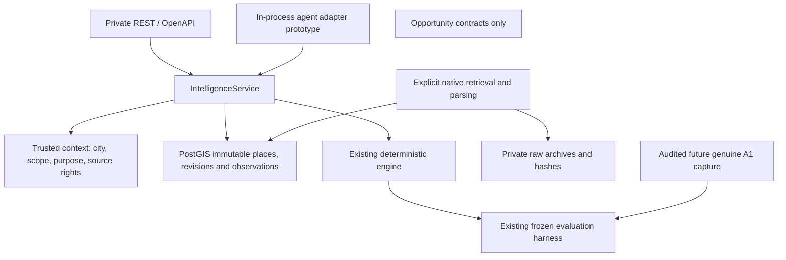

# Agent platform architecture — Sprint 2

CitySense is an urban intelligence infrastructure platform for agents, GIS tools and city
applications. Batumi is the first research environment. The architecture supplies traceable
place evidence and an unvalidated decision hypothesis, rather than claiming human emotion
measurement or proven recommendation quality.

## Implemented ownership

| Module | Responsibility | Boundary |
|---|---|---|
| `platform.py` | City configs, scope/rights, stored state, geometry selection, service methods | No HTTP, provider polling or payment |
| `platform_api.py` | Five routes, key authentication, repeatable read, sanitized errors | No business/scoring duplication |
| `agent_tools.py` | Typed input catalog and service delegation | No MCP server or network transport |
| `native_sources.py` | OSM aggregate and Open-Meteo native mapping, bounded retrieval/archive | Unknown issuance never becomes replay evidence |
| `baseline_capture.py` | Run receipts and matched-budget/envelope checks | No external model execution or scientific sign-off |
| `opportunities.py` | Provider/offer lifecycle and publication contracts | No operational discovery, availability or booking |

The engine has no city switch, network, LLM or registry dependency. Frozen parameters remain
`heuristic-0.2.0`. Source observations are independent of recommendation outputs. Place IDs
are internal identifiers; Google identifiers are optional future aliases.

## Temporal and rights behavior

The knowledge boundary is `decision_at`; target time must follow it. Geometry revisions need
both valid and retrieved times available before the decision. Observation selection uses
retrieval/issuance before decision and applicable target validity. Latest valid time, retrieval
and UUID break ties deterministically. Missing data is exposed; scoring never fills or rescales
missing features. Caller walking estimates remain explicitly unverified hard-constraint inputs.

Raw mapped park counts are spatial aggregates in `count` units and cannot enter fraction
features. Regional forecast candidates retain null issuance and null resolution when absent.
No forecast generation duration is interpreted as issuance. Results include rights, quality,
model/hash where relevant and uncertainty; verified measurements are not fabricated.

## Private runtime and future release requirements

New city routes require `X-API-Key` and a configured operator key; `CITYSENSE_READ_CITIES`
restricts cities. Service context checks scope and publication rights, also for in-process
calls. Existing development calculator/replay behavior remains for Sprint 1 compatibility;
the process must stay on loopback. Do not present the single key as per-user/tenant isolation.

Existing request body/rate bounds and redacted telemetry remain. Future external release needs
TLS at a trusted gateway, scoped rotating hashed keys, identity/dataset permissions, cross-worker
quotas, metering, secret storage, source-rights review, request auditing and independent security
testing. No raw prompts, participant identifiers or precise query coordinates belong in metrics.
Outbound calls use two fixed HTTPS endpoints, no redirects and bounded retries/body sizes;
controlled DNS/egress remains an operator requirement. No startup/background live feed exists.

Promote modules into services only after profiling shows a distinct scaling or isolation need.
First measurements: p95 service/query latency, rows scanned, archive/storage growth, quota rejects,
provider retries and cost per lawful query. Current tests do not establish capacity or SLOs.
