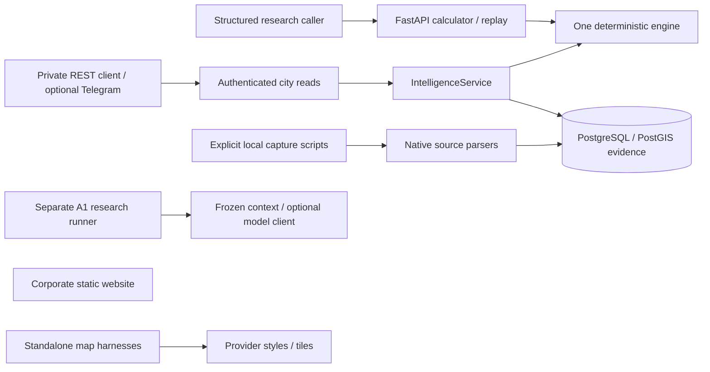

# CitySense codebase readiness audit

Assessment date: **2026-10-14, Asia/Tbilisi**. Assessor: current single-session technical auditor acting across architecture, TravelTech, AI product and security review. This is an assessment, not implementation or independent release QA.

**Judgment: KEEP the foundation, REFACTOR its future tourist-facing contracts and retrieval, REBUILD the tourist/commercial application path, and DEFER transactional commerce and sensor-centric expansion.** Here REBUILD means new implementation for missing subsystems, not deleting or replacing the working foundation. There is useful, tested infrastructure, but no complete contextual tourism discovery or affiliate distribution product. Estimated readiness: **45/100 for an integrated, explicitly synthetic demonstration; 15/100 for a real permissioned pilot.** These are engineering judgments, not completion percentages, measured viability or release permission.

Companion documents: [dependency-ordered gap plan](CITYSENSE_CONTEXTUAL_COMMERCE_GAP_PLAN.md) and [Founder handoff](CITYSENSE_TECHNICAL_READINESS_HANDOFF.md).

## 1. Scope, authority and actual workspace

The attached Founder audit request explicitly authorizes inspection, safe existing local checks, and these three new Markdown reports under `docs/audits/`. It does not approve the new product direction as an amendment to contracts, any implementation, source capture, provider call, integration, account, payment, Git mutation or publication. No application code, database, configuration, dependency or historical report was changed. Offline tests created disposable fixture files in a fresh ignored temporary directory; no persistent application data was written. Public documentation was read through web browsing; no provider API or credential was exercised.

Governance recovery covered the governance index, STATUS, charter, version/decision/reconciliation registers, Chief workflow, role contracts, portfolio/interfaces/risks/backlog, approval ledger, stage gates, accepted ADR-0008/0009/0010, executable API and opportunity contracts, and the newer local landing implementation record. Blueprint v0.4 and AEOS v1.2 remain the canonical direction/process sources; their old embedded headers do not establish an older governing version.

Current branch is `stage/1c-map-navigation`; HEAD is `aae7d9bd52d5e786406896eba94a22abc58cda5d`. `git remote` returned no configured remote. The starting tree was **not clean**:

- Modified: `AGENTS.md`, `docs/governance/FOUNDER_APPROVALS.md`, `docs/governance/README.md`, `docs/governance/STAGE_GATES.md`, and `docs/governance/STATUS.md`.
- Untracked: `apps/`, `docs/design/landing/`, and CR-0001/CR-0002 in `docs/governance/CHANGE_REQUESTS/`.
- Only the root auditor was active; no subagents were started. Existing changes are user work and were preserved.

Before writing the reports, a content inventory of 606 existing tracked/nonignored files outside `docs/audits/` was recorded. Its SHA-256 aggregate was `49705f2d3fbbe9b0a698a2a16f870bef5156f06e9bd826d753d046711ac6654e`. The post-report inventory matched exactly. This verifies preservation during report creation; it is not a clean-checkout or deployment attestation. All report-local links and indexed source line bounds were checked.

The historical STATUS landing overlay is incomplete relative to current files: [the preserved implementation request](../design/landing/implementation/landing-web-local-v1/USER_REQUEST.md), lines 5–53, explicitly accepts LANDING-WEB r2 for initial positioning and authorizes local website implementation. [CR-0002](../governance/CHANGE_REQUESTS/CR-0002-LANDING-WEB-LOCAL-IMPLEMENTATION.md), lines 1–31, records its limited scope. However, the current approval ledger ends at the earlier r2 execution entry; a local implementation Founder packet and dedicated site tests were not located. This is a reconciliation/verification gap, not grounds to discard the actual implementation authority or to infer final site acceptance. PRODUCT-APP UX-0–4, map Stage 2 and publication remain separately gated.

Protected conflicts remain unresolved: CF-01 product-pilot versus research evaluation; CF-02 commercial ordering; CF-03 coverage-aware retrieval versus frozen `/v1` search. The audit proposes changes without changing these contracts. Organic scores/order/hash and B0/A1/B1 protocols must remain intact.

## 2. Evidence index

Paths and line ranges below refer to the **current working-tree bytes**, including the uncommitted landing files. Absence findings combine directory inventory, source searches and traced call paths; they do not infer absence from one filename. E identifiers are used throughout the report.

| ID | Inspected source and relevant lines | Evidence |
|---|---|---|
| E01 | [models.py](../../services/api/src/citysense/models.py), 13–20, 40–87, 99–133, 146–168 | Strict extra-field denial; three needs; numeric evidence lineage; request contains time/max-walk/places, without tourist party/budget/deadline |
| E02 | [engine.py](../../services/api/src/citysense/engine.py), 16–106 | Caller walk exclusion; freshness/validity; all-required-feature abstention; weighted sum and stable tie order; no shortlist cap |
| E03 | [parameters.py](../../services/api/src/citysense/parameters.py), 14–46; [heuristic JSON](../../services/api/src/citysense/parameters/heuristic-0.2.0.json), 1–10 | Content-addressed, explicitly unvalidated fixed weights, per-quality freshness |
| E04 | [platform.py](../../services/api/src/citysense/platform.py), 56–70, 73–130, 146–211 | Trusted access context, revisioned WGS84 point; caller estimates; 30-candidate bound; exactly-two comparison |
| E05 | [platform.py](../../services/api/src/citysense/platform.py), 214–314 | As-of geometry joins, source permissions before LIMIT; radius query; stable-ID cutoff and truncation |
| E06 | [platform.py](../../services/api/src/citysense/platform.py), 242–275, 327–446 | Rights/lineage validation; stored evidence assembly; shared engine invocation |
| E07 | [platform_api.py](../../services/api/src/citysense/platform_api.py), 28–110 | Five authenticated REST read operations; single research operator; read-only transaction; safe errors |
| E08 | [app.py](../../services/api/src/citysense/app.py), 17–60 | FastAPI entry; redacted validation; health/calculator/replay; no startup migrations/feeds |
| E09 | [security.py](../../services/api/src/citysense/security.py), 20–53, 56–162 | Env configuration; production key requirement; optional dev auth; per-process limits; bounded bodies; minimal telemetry/logs |
| E10 | [ingestion.py](../../services/api/src/citysense/ingestion.py), 17–74, 77–216 | Rights metadata/protocol/fake provider; normalized HTTP gateway; bounded retry/cache/circuit/lineage |
| E11 | [native_sources.py](../../services/api/src/citysense/native_sources.py), 20–23, 47–118, 121–181 | Fixed Overpass/Open-Meteo endpoints; explicit research retrieval; bounded archive; mapped way count |
| E12 | [native_sources.py](../../services/api/src/citysense/native_sources.py), 184–258 | Weather parser, temperature/wind units, forecast-candidate status; null issuance, no historical replay eligibility |
| E13 | [real_context.py](../../services/api/src/citysense/real_context.py), 14–59, 62–125 | Up to five tag-free park ways; first in-window boundary vertex, not entrance; local research/cache rights |
| E14 | [db.py](../../services/api/src/citysense/db.py), 16–163; [migration 0001 SQL](../../services/api/migrations/versions/0001_foundation.sql), 2–107, 141–157; [migration 0002](../../services/api/migrations/versions/0002_geometry_revisions.py), 11–34 | Parameterized SQL, append-only sources/places/observations/models/snapshots, geometry revisions and replay integrity |
| E15 | [opportunities.py](../../services/api/src/citysense/opportunities.py), 13–89 | Offer/ProviderEntity/BookingAttribution models and OpportunityReader protocol only |
| E16 | [baseline_runner.py](../../services/api/src/citysense/baseline_runner.py), 127–258, 327–480 | Optional OpenAI Responses research client; invented fixture mode; tool/token/cost/latency envelopes; bounded candidate choice |
| E17 | [telegram_demo.py](../../services/api/src/citysense/telegram_demo.py), 22–38, 47–114, 139–195, 197–308 | Private commands, loopback API client, source checks, max-three output, explicit unknowns; no natural-language parser |
| E18 | [run_telegram.py](../../services/api/scripts/run_telegram.py), 16–60, 63–97 | Optional private polling transport, allowlists, explicit authorization flag, disabled transport logs; no persistence |
| E19 | [agent_tools.py](../../services/api/src/citysense/agent_tools.py), 1–88 | In-process typed delegator/catalog; no MCP server/session/transport |
| E20 | [map.mjs](../../tools/map-stage-1/map.mjs), 79–170, 177–224; [comparison.mjs](../../tools/map-stage-1/comparison.mjs), 1–75 | Isolated provider/camera/language comparison; Mapbox, MapTiler and OpenFreeMap, no recommendation overlay |
| E21 | [Stage 1 serve.py](../../tools/map-stage-1/serve.py), 42–94 | Loopback/Host/exact routes; public Mapbox token prefix check; unfiltered MapTiler env value returned as browser configuration |
| E22 | [navigation.mjs](../../tools/map-stage-1c/navigation.mjs), 7–42, 77–119, 173–243 | Native camera/building controls, diagnostics; live MapTiler style; attribution and sanitized error state; no result data |
| E23 | [Stage 1C serve.py](../../tools/map-stage-1c/serve.py), 10–44, 47–118; [index.html](../../tools/map-stage-1c/index.html), 9–38 | Pinned local SDK/exact routes/key sentinel checks/CSP/Host restrictions; full-height experimental map |
| E24 | [landing build.py](../../apps/landing-web/build.py), 16–104, 107–136, 139–184 | Six static HTML pages, escaped config, contact/release gates, illustrative copy; default no JS/tracking/product integration |
| E25 | [landing serve.py](../../apps/landing-web/serve.py), 8–81; [site.css](../../apps/landing-web/assets/site.css), 1–5 | Loopback-only exact routes/Host/method/CSP restrictions; responsive CSS and reduced-motion rules |
| E26 | [landing package.json](../../apps/landing-web/package.json), 1–12; [photo provenance](../../apps/landing-web/assets/PHOTO_PROVENANCE.json), 1–40 | Advertised build/preview/test/readiness commands; credited historical photo and hashes |
| E27 | [pyproject.toml](../../services/api/pyproject.toml), 1–40; [.python-version](../../services/api/.python-version), 1; [map package.json](../../tools/map-stage-1/package.json), 1–15 | Python/runtime/tool dependency pins; frontend map SDK pins |
| E28 | [compose.yml](../../compose.yml), 1–21; [CI workflow](../../.github/workflows/ci.yml), 1–92; [.env.example](../../.env.example), 1–19 | DB-only digest-pinned local Compose, locked CI quality recipe, documented env names |
| E29 | [conftest.py](../../services/api/tests/conftest.py), 29–68; [test_security.py](../../services/api/tests/test_security.py), 11–75; [test_engine.py](../../services/api/tests/test_engine.py), 13–123 | Integration creates/drops schemas and migrates; meaningful engine/security negative cases |
| E30 | [export_contracts.py](../../services/api/scripts/export_contracts.py), 19–50 | Generated-contract drift check; pure comparison under `--check` |
| E31 | [evaluation.py](../../services/api/src/citysense/evaluation.py), 26–97, 101–147, 315–397 | Protected consent/grouped split/comparison harness; B1 not implemented without supplied comparator |
| E32 | [real coverage report](../REAL_WORLD_DATA_COVERAGE.md), 1–103; [Sprint 3 count receipt](../evidence/sprint-3/test-counts.json), 1–26 | Historical real-geometry abstentions and permission limits; historical full-DB test receipt |

## 3. Actual architecture and component status

There are **no implemented arrows from the landing or map harnesses to the backend**, and no connection from live travel inventory to any client.

| Surface | Entry points/runtime/routing | Actual status |
|---|---|---|
| Research API | `services/api/src/citysense/app.py:create_app` / module `app`; Python 3.12.13, FastAPI/Pydantic, Uvicorn | Implemented, currently checked offline; DB-backed paths historically tested, not rerun here |
| Shared city service | `platform_api.py` → `IntelligenceService` → PostGIS → `engine.evaluate` | Implemented private reads; no end-user identities, activity inventory or guest journey |
| Private Telegram | `scripts/run_telegram.py` → `TelegramDemo` → loopback HTTP REST | Implemented optional adapter; offline/mock cases pass; actual bot connection unverified/disabled |
| Agent surface | `agent_tools.py` and generated JSON catalog | In-process prototype; no network MCP service or externally released agent API |
| A1 research | `scripts/run_a1.py`, `baseline_runner.py`, prospective audit/capture | Research tooling; fixture responses invented; genuine provider execution not established |
| Map Stage 1/1B | `tools/map-stage-1/serve.py`, `index.html`, `map.mjs` | Isolated technology/provider comparison using real basemaps when separately configured |
| Map Stage 1C | `tools/map-stage-1c/serve.py`, `navigation.mjs`, `diagnostics.mjs` | Isolated native-navigation/measurement experiment; current offline checks pass; no tourist results |
| LANDING-WEB | `apps/landing-web/build.py` → generated HTML/CSS; `serve.py`; six exact routes | Local corporate informational demo in untracked user work; generated bytes verified; acceptance/test packet incomplete |
| PRODUCT-APP | No active tourist web/PWA application found | Unbuilt. No React/Vue/Next/Streamlit app, user search form, synchronized shortlist/map state or service worker found |
| Opportunity registry | `opportunities.py`, generated provider schema | Contract-only; no concrete OpportunityReader, storage/feed or booking action |
| Legacy infrastructure | `infra/sql/001_foundation.sql` | Historical proposal; README directs users to Alembic instead; do not apply alongside migrations |
| Rejected digital twin | Ignored rollback archives under `.local/rollback-archives/` | Archived/rejected prototype, outside current active app. Not counted as reusable running capability; archived modules were not re-audited |

Persistence uses psycopg and SQL directly, with Alembic owning migrations. SQLAlchemy is installed and used by migration infrastructure, not evidence of a second business-data ORM. Model artifacts/snapshots preserve frozen inputs; dynamic city reads do not automatically create replay snapshots. Append-only research state is unsuitable as a default store for revocable guest/affiliate data. E14, E31; [API contract](../OPENAPI_CONTRACT.md), lines 59–61.

Installed inspected runtime: Python **3.12.13**, Node **v24.16.0**, MapLibre **6.13.0**, Mapbox GL **3.32.0**. Existing venv metadata matches all inspected pins: FastAPI 0.143.0, Pydantic 2.14.0, HTTPX 0.28.1, psycopg 3.3.6, Alembic 1.20.0, SQLAlchemy 2.0.48, python-telegram-bot 22.8, and pinned dev tools. No install was performed. Node is not pinned by a repository engine/version file. LANDING-WEB has no npm dependencies and generates static HTML with Python; `prepare_images.py` is an optional pre-existing image-preparation step requiring Pillow, not a runtime frontend framework. Existing WebP assets avoid needing to run it.

Configuration uses environment variables listed in E09/E18/E21/E23/E28, packaged city/weight JSON, and explicitly supplied landing factual JSON. No root `.env` exists, and all inspected process variables for DB URLs, operator/model/Telegram credentials and map browser credentials were empty/unset. This establishes **no configured credentials in this inspected invocation**, not absence in every terminal, secret manager, old local archive or external account. No secret values were displayed or used.

## 4. Functional readiness matrix

READY means implemented **within the stated boundary** with relevant checks; it never means the whole product is release-ready. PARTIAL includes reusable implementations insufficient for the requested tourist capability. MOCK means simulated inputs/behavior. ABSENT means no active implementation identified. BLOCKED means a material access/permission prerequisite, even when component code exists.

| Capability | Classification | What exists / exact limitation | Evidence |
|---|---|---|---|
| Visitor intent input | PARTIAL | Private structured commands and direct JSON; no natural-language tourist form/parser | E01, E17, E24 |
| AI intent interpretation | ABSENT | OpenAI client is a frozen research-choice runner, not an intent-to-constraints pipeline | E16–E18 |
| Constraint handling | PARTIAL | Finite caller walk limit precedes scoring. Party/age, monetary budget, activity duration, return deadline, access/safety facts are not represented | E01–E04 |
| Context acquisition | PARTIAL | Stored as-of evidence and explicit native retrieval components; no operational context aggregation for tourist requests | E06, E10–E13 |
| Weather integration | PARTIAL | Real endpoint/retriever code and tested fixture parser; no configured/authorized live feed, issue metadata or score mapping | E11–E12 |
| Geographic context | PARTIAL | WGS84 points/revisions and PostGIS radius search; no device geolocation, verified entrance, route, ETA or return trip | E04–E05, E13 |
| Places/activities | BLOCKED | Historical real OSM boundary records have missing features and publication restrictions; no permitted operational activity inventory | E13, E32 |
| Recommendation generation | PARTIAL | Shared deterministic scorer over caller-specified or stored candidates; no tourist eligibility/retrieval orchestrator | E02, E05–E06 |
| Ranking | PARTIAL | Deterministic, explanatory weighted research heuristic; no validated tourism comparative-relevance policy | E02–E03 |
| Up-to-five presentation | ABSENT | Engine returns all assessed input candidates; Telegram caps three; no five-option tourist shortlist | E02, E17, E24 |
| Map visualization | PARTIAL | Real basemap/camera experiments; no recommendation pins, card comparison or selection/evidence linkage | E20–E23 |
| Contextual visualization | ABSENT | Camera/building/language controls are implemented, but request/context cannot change result overlays | E20, E22 |
| Partner redirection | ABSENT | OSM coordinate links and photo/license credits only; no activity referral destination service | E17, E24 |
| Affiliate tracking | ABSENT | BookingAttribution is unused contract data; no partner IDs/subIDs/link builder/click persistence | E15, E24 |
| Conversion analytics | ABSENT | Technical route/status/latency counters only; no tourist funnel, order reports or provider confirmations | E09, E15 |
| Hotel distribution | ABSENT | Partners website describes future participation; no QR/campaign/guest-entry implementation | E24 |
| Paid access | ABSENT | No checkout, payment webhook, funded access, entitlement or refund runtime | E15, E24 |
| Local partnerships | PARTIAL | Rights-aware point ProviderEntity and Offer contracts exist; no verified partner/runtime reader | E15 |
| Localization | PARTIAL | Stage 1 map label experiments support language adaptation; landing HTML/Telegram messages English; no EN/KA UI catalog or fallback architecture | E17, E20, E24 |
| Mobile usability | PARTIAL | Landing responsive/reduced-motion CSS and map flex layout exist. No current physical-device or integrated product usability evidence | E23–E25 |
| Error handling | PARTIAL | Strong research API/input/provider/missing-data controls checked; no tourist frontend loading/retry/stale-selection states | E02, E07–E12, E17 |
| Privacy/security | PARTIAL | Private operator auth, redaction, limits, source policy and restrained static site. Guest auth, consent, deletion and external release controls absent | E07–E10, E14, E25 |
| Deployment | PARTIAL | Pinned backend/DB/CI recipe and existing static site build output; no production app packaging/HTTPS host or current hosted CI evidence | E24, E27–E29 |

Synthetic evidence/fixtures, FakeProvider and A1 FixtureClient are **MOCK inputs**, not live tourist facts. The deterministic engine and map renderer are real implementations; calling the entire backend or basemap a mock would also be incorrect.

## 5. Trace of the representative tourist request

Request: three free hours, outdoor activity, two adults plus one child, defined monetary budget, return to accommodation before a fixed time.

**First exact failure:** no active visitor web input or natural-language interpreter accepts this request. Sending the sentence to the private Telegram adapter falls back to command help (`telegram_demo.py`, 209–248). Trying to preserve its constraints in `EvaluateRequest` or `SuitabilityQuery` rejects extra fields (`Contract.extra='forbid'`), rather than enforcing them. The offline audit confirmed `adults`, `children`, `budget_amount`, `budget_currency`, `duration_minutes`, and `return_by` each fail with `extra_forbidden`. Reducing the request to `family_walk` would lose requirements and is not a valid workaround.

| Step | Current code responsibility | Real, simulated or missing outcome |
|---|---|---|
| 1. Enter need | Landing `home()` at E24; Telegram `handle()` at E17 | Website shows explanatory text only. Telegram supports commands, not free-text needs. Tourist entry missing |
| 2. Parse request | `Need` enum / Telegram split-and-position parsing, E01/E17 | Real deterministic parsing of narrow commands; no AI/NL parsing or clarification |
| 3. Preserve group | E01/E04 request models | Missing adult/child counts, child ages and product age-band eligibility. `family_walk` is a category, not verified child suitability |
| 4. Represent time | `decision_at`, `target_time`, E01/E04 | Real as-of/forecast timestamp semantics; no visit length, latest departure, opening interval or return deadline |
| 5. Enforce budget | E01/E02; Telegram 253/291 | Missing monetary budget enforcement. Telegram variable named `budget` is maximum walking minutes. Offer optional price is not connected |
| 6. Obtain location | SearchQuery coordinates, E04; Telegram 264–283 | Caller may manually supply coordinates. Shared Telegram location produces help (E18 dispatch), not computed geolocation or accommodation state |
| 7. Weather | E11/E12 | Fixture-tested temperature/wind forecast candidates; no operational request-time weather or rain/storm eligibility |
| 8. Source candidates | E05/E13 | Real bounded stored-place spatial retrieval; historical OSM park ways, not activity products. Stable-ID cutoff can precede suitability |
| 9. Verify availability | E15 | Schema states/check expiry only; no provider reader/call. Current availability unknown |
| 10. Reject unsuitable | E02 | Walk-time rejection and feature abstention work. Budget/child/access/return requirements cannot be evaluated |
| 11. Select alternatives | E02/E17 | Weighted research order; no five-option tourism selector. Real restricted inventory historically yielded four abstentions and one invented-walk exclusion |
| 12. Show map results | E20/E22 | Standalone basemaps load only with separate provider configuration; no backend candidates or result pins reach them |
| 13. Select activity | E24/E22 | No product selection, request revision, shared card/map identity or action state |
| 14. Validate URL | E15/E17/E24 | No provider activity URL exists to validate. Numeric OSM links are navigation references, not booking destinations; no network URL validation performed |
| 15. Track attribution | E09/E15 | No affiliate click/subID/hotel session pipeline; API technical telemetry cannot observe a purchase |
| 16. Finish/measure | E31 | Research paired-choice tooling exists, but no tourist completion instrument/funnel or provider-confirmed commercial outcome |

The scenario therefore cannot finish in the current product. Even a manual structured approximation reaches additional inventory/rights, tourist eligibility, map integration and referral failures. A historical synthetic score or populated basemap does not resolve these failures.

## 6. Recommendation engine review

Current mechanism: **static need categories + caller walk exclusion + numeric freshness/validity gates + fixed weighted sum + deterministic score/ID order** (E01–E03). `family_walk` uses shade 0.35 and greenery 0.65; `cool_walk` uses shade 0.65 and greenery 0.35; `quiet_rest` uses traffic-proximity proxy 0.70 and greenery 0.30. These are explicit hypotheses. The positive traffic feature denotes quieter/farther from traffic, not measured decibels. No embeddings, semantic search, keyword recommender, learned production ranker, external travel search or AI-generated live recommendations were found. A1 makes research choices separately; B1 requires a supplied comparator and is not an implemented trained product model (E16/E31).

Useful protections to retain:

- Walking exclusion is distinct from scoring; all weighted required inputs must be present/fresh, otherwise `score=None` and `insufficient_data`.
- No missing-value renormalization, synthetic fifth option, invented price/rating or confident psychological claim is inserted.
- Scores/components/reasons, coverage, parameter version/hash, chronology and source identifiers are exposed. Stable tie ordering is repeatable.
- The service resolves stored evidence/rights/geometry and calls the same engine. Telegram excludes null-score entries from recommendations and explains unknowns.

Limits relative to tourist comparison:

- Eligibility currently verifies **only the supplied walking estimate**; feature completeness is not a generalized safety/access/budget/time/group check. High shade/greenery cannot verify suitability for a child.
- The engine may return 100 assessments, including null-score records; it does not produce a tourist shortlist. In-memory audit supplied seven synthetic candidates and received seven ranked entries; with all features removed, all seven scores stayed null.
- Search bounds apply by stable ID before suitability and without a cursor (E05); Telegram `/near` additionally takes the first three allowlisted places before scoring. Coverage-aware retrieval requires the CF-03 contract/version decision, not silently changing existing search.
- `missing_features` reports missing numerical inputs, not valid eligibility: present but stale features still appear with separate freshness flags. Clients must consume the actual assessment/freshness rather than interpreting an empty missing list as permission to recommend. This matches the existing API contract.
- Static weighted research scores can support a labeled legacy comparison, but have no validation as activity preference, safety or probability of being best. They should not become the general tourism ranking function by renaming labels.

**Retain** engine/replay/evidence controls and frozen B0. **Design an additive, approved decision contract** for tri-state tourist eligibility and simple comparative ordering. Return eligible alternatives with meaningful differences, including fewer/none, and explain unknown required facts separately. A small deterministic rules policy and user preference controls suffice initially; no complex ML is justified by current data. No proposed commercial weighting should touch organic scoring/order/hash while CF-02 remains unresolved.

## 7. External integrations: actual runtime and permissions

No operational travel provider adapter exists. Named providers in planning/corporate text do not establish credentials, commercial approval, inventory or conversions.

| Integration | Implemented endpoint/SDK and authentication | Schemas / errors / retry / cache / lineage | Actual operational/permission status |
|---|---|---|---|
| Google Maps Platform / Places / Routes | None found in active source or manifests | No client/request schema/key/env binding | ABSENT; any adoption needs vendor/usage approval; no routing implementation |
| MapLibre + MapTiler | MapLibre 6.13.0; `api.maptiler.com/maps/streets-v4/style.json`; browser-public key from `MAPTILER_API_KEY` or legacy alias | Style JSON and provider tiles; 30s style timeout; sanitized failure, no application-level retry/cache; style hash/SDK/camera diagnostics. Provider attribution/logo | PARTIAL experiment; no key in this process; live rendering not run. Existing source/license/capture review does not prove current production account permission |
| Mapbox GL | SDK 3.32.0; `mapbox://styles/mapbox/standard`; `MAPBOX_PUBLIC_ACCESS_TOKEN` or legacy alias, `pk.` checked | SDK style/tile behavior; sanitized harness errors/diagnostics; no custom data cache/retry | PARTIAL provider-comparison experiment; no configured process token or current live verification |
| OpenFreeMap / OSM basemap | MapLibre and `https://tiles.openfreemap.org/styles/liberty`; no key | Style/tiles, timeout and sanitized failures in Stage 1 harness; SDK-managed rendering | PARTIAL alternative basemap experiment. Rendering data does not grant access/availability facts or carte-blanche redistribution |
| OSM / Overpass | Fixed `https://overpass-api.de/api/interpreter`, numeric bounded aggregate/geometry queries; no API-key binding | RetrievedPayload/Observation/RealInventory; two attempts, 20s phases, bounded numeric Retry-After, 256KiB response; explicit archival permission/hash/timestamps; no background feed | Implemented research capture component; historical five real boundary geometries. Current private derivative publication/commercial/LLM-transfer clearance absent (E32) |
| Open-Meteo | Fixed `https://api.open-meteo.com/v1/forecast`; no API-key env consumed by existing retriever | WeatherSample with temperature/wind, source/hash/valid/retrieved time, null issued time; common bounded native retry; explicit archive, no automatic cache substitute | PARTIAL parser/retriever; fixture-tested, live use not established. Output is a forecast candidate outside historical replay; no tourist weather policy |
| Normalized HTTP gateway | Operator-configured allowlisted HTTPS URL, injected HTTPX client; no standalone auth env schema | SnapshotQuery → list[Observation]; max 3 default attempts/5s phase, 1MiB cap, bounded 429/jitter, TTL 60s/128 entries, circuit after exhaustion, lineage/retrieval validation | PARTIAL generic boundary, not a licensed weather/places/travel integration; no active caller/feed found |
| OpenAI | Research-only HTTPX client, fixed `https://api.openai.com/v1/responses`; server-side bearer from `OPENAI_API_KEY` in explicit runner script | RunnerConfig/Choice; `store:false`, frozen tool/context, output/model/usage checks, exclusive hash-chained receipts; request/tool/token/cost/latency bounds; fixed 1s bounded 429 retry, no timeout retry; no inference cache | Implemented optional client, MOCK fixture execution established; real account/model run not established. No visitor intent parser or tourist startup model calls |
| Telegram | python-telegram-bot 22.8, private long polling; `CITYSENSE_TELEGRAM_TOKEN`, user/place/mode env allowlists | Typed REST results, 5s loopback client, 20s dispatch bound, 256KiB response and 3900-character output cap; no stale result/history cache | PARTIAL transport; real bot not verified, no token here. Real private inventory publication remains blocked |
| GetYourGuide / Viator / Tiqets / Travelpayouts / Booking.com | No active SDK/endpoint/key binding/link adapter | No inventory normalization, product cache, availability, pricing, attribution or reporting implementation | ABSENT implementation and BLOCKED live activation until actual granted access/terms; no approval inferred |
| Meni.ge or other local commercial system | Planning mention only in opportunity design | No active client/credentials/runtime | ABSENT; discussed supplier is not an approved partner |
| OpenTelemetry | API spans/in-process counters | Static route/status/latency only; no exporter/collector/funnel or distributed event store | Implemented telemetry stub; not conversion analytics |

SourceMetadata records legal-purpose flags, terms URL and review time; code verifies internal consistency, not legal authority. Named live-source rights are still an independent review input. Endpoint constants and schemas are implementation evidence, not proof of live service operation.

Affiliate links and inventory access are different permissions. Official public documentation reviewed on this assessment date supports that distinction: [GetYourGuide API requirements](https://partner.getyourguide.support/hc/en-us/articles/13981133907613-API-integration-and-requirements) distinguish teaser, reading and booking access; [Viator access levels](https://partnerresources.viator.com/travel-commerce/levels-of-access/) distinguish basic, full and booking access, with approval/certification for higher levels. Neither proves CitySense acceptance or usable Batumi inventory. Do not build the pilot assuming unrestricted GetYourGuide live inventory; verify the available access level before choosing an adapter.

The existing Open-Meteo public endpoint cannot simply be promoted to a commercial feed: its current [pricing/access page](https://open-meteo.com/en/pricing) distinguishes noncommercial free access from licensed customer access. A commercial endpoint/key mapping is not in existing code. Browser-public map keys are expected client-visible credentials and need appropriate restrictions; [MapTiler guidance](https://docs.maptiler.com/guides/credentials/api-key/) describes allowed-origin protection. No account setting was inspected or changed.

### Normalized activity model: equivalent exists only partially

E15 already provides identity, category/title, optional price/currency/duration, dated availability state and source rights. ProviderEntity requires point geometry and place/city identity; it lacks a provider product identity per offer, referral URL and affiliate metadata, group/age constraints, detailed slots/quotes and request-specific price semantics. BookingAttribution is an unused record shape, not a click/referral service. OpportunityReader has no concrete implementation or app import path.

The minimal proposed additive model and capability-based provider boundary are in the gap plan. Extend through approved versions rather than weakening existing point contracts or putting business facts into normalized numeric environmental Evidence. A deep link always leaves availability unknown unless an independent authorized check supplies it.

## 8. Hotel distribution and monetization

Hotel-specific links/QRs, partner branding, activation attribution, click attribution, guest sessions, paid/funded/hybrid access, entitlements, revenue reports, reconciliation and reversal handling are **absent**. An internal `tenant_id` in AccessContext/BookingAttribution is not tenant isolation, hotel attribution or a customer account. The Partners page is explanatory; it neither onboards a hotel nor collects a guest. Ten-GEL pricing is an experimental business hypothesis and has no code/configuration/approved billing meaning.

A small pilot could use one deployment, a small server-owned hotel/campaign registry, an opaque random guest session, one shared request revision and a narrow permitted event ledger. Hotel code is an attribution label, not authentication or proof of a stay. Referral/subIDs must be opaque and approved by the provider. Real conversions remain unobservable from a click alone; without authorized provider reports/callbacks, report clicks/selections only. Funded/free access can avoid payment processing, but requires a defined access policy. Further design and permission dependencies are in the gap plan.

## 9. Map/context architecture and sensor history

| Investigation | Finding |
|---|---|
| SDK/library | MapLibre GL and optional Mapbox GL. Stage 1C reuses installed Stage 1 MapLibre; MapTiler Streets v4 is provisional |
| Location representation | Backend WGS84 `[longitude,latitude]` point with revision/source/validity; maps use canonical fixed camera presets. Captured OSM point is a boundary vertex, not entrance |
| Five distinct results | Not implemented or verified. Neither active harness creates CitySense result sources/layers/markers; no fit-to-results or overlapping-pin strategy |
| Zoom behavior | Native camera zoom/pitch and provider layer minzoom/building visibility; no context-aware result aggregation or rank visualization |
| Geographic comparison | Stage 1 comparison juxtaposes **basemap providers**, not tourist alternatives; Stage 1C navigates one map |
| Heatmap/RGB | No active CitySense heatmap or sensor RGB business layer found. Provider style colors are basemap styling; static landing color/diagram states are illustrative. Archived rejected digital twin cannot be counted as measured sensing |
| Recommendation metadata | No API fetch or bridge from `SuitabilityResult`/request/selection into the maps |
| Context updates | No visitor context or alternative-update state; presets/building toggles do not constitute recommendation context |
| Mobile | Flex full-height experimental host and controls exist; 30px experimental control minimums (E23) are not accepted tourist touch design. Physical-device and integrated visual approval remain unverified |
| Attribution/rights | MapTiler attribution control/logo and safe provider links exist; Stage 1 uses attribution control and provider distinctions. Terms/account restrictions/physical screenshots/public usage still require separate review |

Reusable pieces: canonical cameras, native `jumpTo`/`easeTo` with reduced-motion behavior, diagnostics/error/context-loss handling, SDK/worker wiring, language-label experiment, attribution and exact-route local hosts. New product map work needs lawful reference evidence, Stage 1B closure/waiver and separate approval; it cannot inherit LANDING-WEB acceptance.

Preserve environmental/source/evaluation modules as bounded research assets. Their shade/greenery/traffic constructs should be optional context if justified for a tourist task; do not force all tours through these features or add urban sensing/3D/heatmaps to the commerce critical path. No deletion is recommended.

## 10. Security, reliability and production findings

No confirmed current external compromise or exposed real credential was found. Findings below distinguish implemented unsafe paths, missing production controls and conditional future risks. Priority P0 means blocks dependent live release; P1 means fix before that surface is used; P2 means bounded hardening/verification. This prioritization does not authorize a fix.

| Finding / status / priority | Exact location | Risk and impact | Recommended remediation |
|---|---|---|---|
| SEC-01: dev auth/replay isolation boundary; confirmed behavior, conditional exposure; P0 before external use | `security.py` 22, 39–52, 102–106; `app.py` 41–55; `db.py` 144–150 | Development defaults permit legacy calculator/replay without a key; replay queries UUID only, with no per-user/source-publication check. Publicly binding this configuration with DB state could expose private research. Current documented loopback operation and absent DB config prevent concluding an active leak | Keep research loopback-only; create a guest-safe scoped service/gateway, production startup/ingress checks and separate dataset ownership/rights policy. Never copy operator key into browser |
| SEC-02: accidental MapTiler secret transmission path; confirmed source defect; P1 for Stage 1 reuse | `tools/map-stage-1/serve.py` 52–68 | Any value in MapTiler env/alias is serialized to browser config, unlike its Mapbox prefix check or Stage 1C sentinel validation. A mistakenly assigned account secret could be exposed to a browser; no configured secret or actual leak observed | Align validation with separately authorized browser-key policy, reject known secret/malformed inputs, require restricted intended key; later add a denial test. Preserve historical harness until a scoped fix |
| SEC-03: shared operator identity/quotas; confirmed limitation; P0 for guest/hotel release | `platform_api.py` 32–47; `platform.py` 56–70; `security.py` 74–122 | One key maps every caller to research operator/cities/scopes. `tenant_id` is not row ownership. Per-peer memory quotas do not coordinate workers and may aggregate all guests behind ingress | Narrow server-side guest sessions/scopes; approved commercial/publication rights context; trusted proxy policy and appropriate quotas; test cross-session access. A full IAM/multi-tenant SaaS is unnecessary for the pilot |
| SEC-04: immutable storage versus deletion/revocation; confirmed architecture gap; P0 before collecting guest/partner data | migration 0001 SQL 102–107; migration 0002 29; `db.py` 20–40/115–150 | Evidence triggers prevent ordinary update/delete; there is no implemented consent expiry/withdrawal/revocation workflow. Reusing this store for precise guest locations or revocable partner data would obstruct policy compliance | Keep personal/events/campaign/entitlement records in separate retention-managed tables; minimize location, approved purposes and deletion jobs; enforce source withdrawal without altering protected scientific history |
| SEC-05: incomplete network/deployment protection; confirmed absence, exposure unverified; P0 for public backend | `app.py` 17–23; `security.py` 132–154; compose 1–21; CI workflow 1–92 | API has no TrustedHost/CORS middleware, HTTPS ingress or body-read deadline. CORS absence denies cross-origin JS; it is not permissive CORS. Slow reads/multiworker quota bypass and superuser DB use need production controls. Compose starts DB only | Approved HTTPS host/ingress timeouts, exact allowed origins/hosts, least-privilege DB roles, backup/restore and structured monitoring; exercise slow request/outage/rate behavior |
| SEC-06: missing landing tests; confirmed failed check; P1 before site acceptance | `apps/landing-web/package.json` 6–11; absent `apps/landing-web/tests/` | Advertised unittest discovery fails. Working generated pages do not substantiate safe-host, responsive, keyboard or acceptance claims; no implementation review packet found | Complete existing bounded local site work with meaningful link/config/host/method checks and separately authorized actual visual QA/Founder packet. This audit supplies no visual acceptance |
| SEC-07: unreviewed affiliate URL/attribution boundary; ABSENT runtime, prospective risk; P0 before commerce | `opportunities.py` 78–89 and lack of referral endpoints in `app.py`/`platform_api.py` | No link builder/allowlist or attribution authentication exists. A future arbitrary `url=` redirect or raw hotel code as entitlement would allow abuse. No existing open redirect was identified | Server-resolved approved destination records, exact HTTPS destination policy, opaque subIDs, session-bound request/candidate and permitted reporting; reject caller URLs/destination overrides |
| REL-01: eligibility and location overclaims; confirmed missing semantics; P0 for tourist use | `models.py` 108–133; `platform.py` 160–184; `real_context.py` 30–33/106–112 | Caller minutes, boundary vertices and greenery scores cannot guarantee return time, child suitability, access, opening or budget. Presenting them as such would make misleading recommendations | Versioned request/tri-state evidence and full-trip feasibility checks; visibly unknown unsupported facts; true entrance identity and independently reviewed inventory |
| REL-02: bounded ID retrieval; confirmed behavior; P1 for recommendations | `platform.py` 288–313; `telegram_demo.py` 274 | Eligible candidates outside early ID cutoff are never considered; may distort coverage and comparisons | Resolve CF-03; additive coverage-aware retrieval with measured termination/truncation and permission filtering before ranking; preserve `/v1` |

Positive controls confirmed by code/tests: strict extra/finite/chronology constraints; parameterized identifiers/SQL; no arbitrary remote user URL in ingestion; fixed research model tool envelope and candidate validation; constant-time operator key check; sanitized errors/logs; size/rate limits; provider redirects disabled; no stale cache fallback; source publication checks; no remote `local_research` request field; static landing escapes configured text, denies scripts/connections/forms/geolocation in preview and serves only exact paths. E01/E07–E12/E16/E19/E25/E29.

Input injection and model-generated tools are contained in the existing narrow research boundaries, not tested for a future NL parser/provider description ingestion. No production payment boundary exists. No affiliate tampering exploit can be claimed without an affiliate pipeline. Default Uvicorn instructions suppress access logs; using a different host/reverse proxy could reintroduce location/query logs, so future hosting data flows require review.

Dependencies: existing lockfiles and Dependabot/CI security checks provide useful reproducibility. Retained `artifacts/sprint3/final-checks/dependency-audit.json` reports no vulnerabilities in that historical Python audit. **No fresh dependency vulnerability database query or npm audit was performed**, so there is no current zero-CVE claim. Current Bandit passed for backend source only. Landing/image tooling and map JS are not covered by that Bandit result. The current test warning about Starlette/HTTPX is a maintenance compatibility warning, not an identified security vulnerability.

## 11. Checks actually performed and limits

All current executions were local on the existing Windows installation, using `services/api/.venv/Scripts/python.exe` with `-B`, without package installation or loading credentials. No screenshot/browser/map-style request, migration, DB integration suite or live external provider call was performed. Loopback map-server tests used their temporary local test host and shut it down.

| Check | Actual result | Interpretation |
|---|---|---|
| Git branch/HEAD/status/remote; active-agent list | Existing modified/untracked work recorded; no remote; root only | Workspace state, not a clean release |
| Installed dependency metadata and SDK package versions | Inspected pins matched; Python 3.12.13, Node v24.16.0 | Existing environment usable, fresh clean install not proved |
| Backend: `python -B -m pytest -q -m "not integration" -p no:cacheprovider` | Initial attempt: **122 passed, 26 setup errors, 31 deselected**; Windows temp root permission failure | Environment failure preserved; not application assertion failures |
| Same backend suite with `--tb=short --basetemp` set to a fresh unique ignored `.local/tmp/readiness-audit-*` directory | **148 passed, 31 deselected, 1 warning**, 10.36s | Offline nonintegration suite passed. Existing files were never reused/deleted as a test base |
| `node --test tools/map-stage-1c/tests/navigation.test.mjs` | **18 passed** | Camera/diagnostics/SDK wiring checks; no live visual/performance acceptance |
| `python -B -m unittest discover -s tools/map-stage-1c/tests -v` | **9 passed** | Exact assets/Host/key denial/HEAD behavior; no provider access |
| `scripts/export_contracts.py --check` | **Contract exports match** | No generated contract drift |
| `python -B -m ruff check --no-cache src tests migrations scripts` | **All checks passed** | Existing backend lint only |
| `python -B -m bandit -r src -q` | **PASS**, no reported findings | Backend static SAST only, not threat-model certification |
| Landing advertised command, `python -B -m unittest discover -s tests -v` from `apps/landing-web` | **FAIL**, `Start directory is not importable: 'tests'` | Dedicated landing tests missing |
| `apps/landing-web/build.py --check-readiness` | **BLOCKED**, nonzero exit | Five missing inputs: actual approved HTTPS origin, publication authorization, hosting/privacy facts, legal applicability decision, approved disclosures. No blanket incorporation prerequisite inferred |
| Read-only source-to-dist comparison in memory | All **6 HTML pages** matched current page-generation functions; **14 manifest file hashes** matched disk | Existing output corresponds to source; no rebuild or rendered mobile QA |
| In-memory request/engine inspection using synthetic fixture | Six unsupported tourist fields rejected; seven candidates returned; all missing features produce seven null scores | Concrete schema/shortlist/abstention boundaries; no empirical claim |

The backend warning says Starlette's current TestClient integration deprecates HTTPX in favor of HTTPX2. No package change was made. DB integration is not a safe read-only check: E29 creates an extension/schema, runs migrations and drops its schema. It requires explicit disposable-DB mutation authorization and a configured `_test` database. None was configured in this invocation. Historical Sprint 3 receipt records 179 passed including 31 PostGIS cases; this audit reports those as historical, not current execution.

Not run: mypy/format checks, new clean install, full CI/check.py, Docker, load test, current vulnerability feeds, actual TLS/hosted deployment, physical EN/KA/mobile/accessibility acceptance, genuine A1 provider run and all commercial/affiliate checks. The full local check runner exports/audits/writes artifacts and runs tests that can mutate a disposable DB; its lock/dependency gates can require external access. The CI recipe additionally installs dependencies. Neither was invoked as if read-only. These omissions constrain release conclusions.

## 12. Readiness scores

Scale: 0 = no relevant implemented capability; 25 = useful isolated pieces; 50 = integrated partial functionality; 75 = mostly complete with substantial verification still outstanding; 100 = intended capability with required permissioned operation and relevant acceptance evidence. Scores use the target tourist experience, not isolated subsystem maturity. They are subjective, rounded technical estimates; a gate can prevent release regardless of score.

| Dimension | Score /100 | Repository support and limiting evidence |
|---|---:|---|
| Frontend/UI | **25** | Six working corporate pages and responsive CSS; no tourist input/comparison/selection app or current physical visual acceptance. E24–E26 |
| Map/geography | **45** | Real SDK/cameras/attribution, revisioned points/spatial search and 27 map checks; no result overlays, route/ETA/entrances or physical-device sign-off. E04–E05/E20–E23 |
| Recommendation/constraints | **40** | Tested deterministic engine, stale/missing abstention and walk exclusion; narrow enum/features, no budget/group/return model or coverage shortlist. E01–E06 |
| Context-data integration | **20** | Lineage/rights/native parsers and as-of stored evidence; no operational weather/context and real inventory zero-score coverage. E10–E13/E32 |
| Travel provider integrations | **5** | Useful Offer/ProviderEntity shapes only; no concrete product/availability adapter. E15 |
| Affiliate/deep links | **5** | Attribution contract and truthful disclosure groundwork; no activity URL, approved link builder or click pipeline. E15/E24 |
| Hotel distribution | **0** | Prospective partner copy; no hotel/campaign/QR/session/entitlement runtime. E24 |
| Analytics/attribution | **5** | Technical counters only; no guest funnel, consent/event ledger or provider reconciliation. E09/E15 |
| Security/privacy | **40** | Passing private-boundary negative checks and careful data handling; external guest authorization/retention/gateway/revocation and production assurance missing. E07–E10/E14/E25/E29 |
| Deployment/testing | **45** | 175 current offline tests pass across backend/maps, contract/lint/SAST pass, pinned backend/DB/CI recipe; landing test failure, no current DB/hosted/Linux/production/physical QA. E27–E30 |

**Demo readiness: 45/100.** A coherent labeled demo is attainable by joining reusable pieces and introducing a narrow approved tourist contract with synthetic eligible/unknown/rejected fixtures. Today's corporate website and basemap separately explain/show pieces; they cannot execute the representative scenario.

**Real pilot readiness: 15/100.** Current blockers are usable inventory/rights, tourist constraint/retrieval contract, guest-safe integrated mobile flow, provider/link permissions and privacy/observable events. Missing any required hard fact must still prevent eligibility. No arithmetic mean of the dimension scores is used; no calendar guarantee follows.

## 13. Architectural disposition

| Major subsystem | Decision | Reason / evidence |
|---|---|---|
| Modular backend/shared service/REST | **KEEP** | Real one-service composition, rights checks, safe error mapping and tested private contracts. E06–E09 |
| Frozen research engine/parameters/replay | **KEEP** | Deterministic, transparent, abstains and preserves evidence; never rename as validated tourist ranking. E01–E03/E14/E31 |
| Tourist constraints/recommendation orchestration | **REFACTOR with additive layer** | Current inputs are unsuitable; use approved new contracts/simple eligibility rules while preserving legacy B0 and `/v1`. E01/E04–E06 |
| Search for tourist shortlist | **REFACTOR after CF-03** | Early bounded stable-ID retrieval is appropriate private API semantics but incomplete tourism retrieval. E05/E17 |
| Map renderer/cameras/diagnostics | **KEEP / REFACTOR integration seam** | Native map pieces useful; new identity/result/selection overlay needs approval and tests. E20–E23 |
| Tourist frontend/shared state | **REBUILD (new implementation)** | No active tourist UI to refactor; this requires new code, not restoration of a working app. Corporate website remains separate. E24–E25 |
| Source metadata/ingestion/native parsers | **KEEP / REFACTOR provider mappings** | Useful typed boundaries; need commercial weather/lawful activity specifics and honest unknowns. E10–E13 |
| Travel-provider adapters/referral service | **REBUILD (new implementation)** | Contracts are reusable seeds, inventory/referral runtime absent. E15 |
| Guest/hotel/analytics boundaries | **REBUILD (minimal new modules)** | One-operator platform is not guest access, campaign attribution or consent-managed analytics. E07/E09/E15 |
| LANDING-WEB | **KEEP / finish existing bounded verification** | Actual local corporate pages; missing dedicated tests/implementation packet. Does not transfer PRODUCT-APP acceptance. E24–E26 |
| Payment/entitlements/reconciliation transactions | **DEFER** | Undefined business model, permission and liability; price hypothesis cannot justify checkout. E15/E24 |
| Sensor-first/3D/heatmap expansion | **DEFER / isolate research** | No evidence of value for the initial tourism job; preserve useful existing evidence/camera tools and archives. E02/E22/E31 |
| A1/B1 research and public MCP/agent release | **DEFER from commerce critical path** | Separate research protocol; genuine A1/B1 and external authorization/transport remain unverified/unbuilt. E16/E19/E31 |
| Legacy SQL/rejected prototypes | **DEFER / preserve archival separation** | Alembic is active migration owner; ignored rejected prototypes are history, not product assets |

The smallest next experiment is a bounded **offline constraint-validity comparison**: a reviewed request for this scenario, 6–8 explicitly synthetic activities, deterministic eligible/ineligible/unknown outcomes, fewer/none behavior and evidence-bound comparison. It needs no affiliate account or provider call. A later map/UI experiment requires its own PRODUCT-APP/map/UX approval; the current audit authorizes neither. See the gap plan for a concrete 12–20-hour scope and subsequent milestones.
