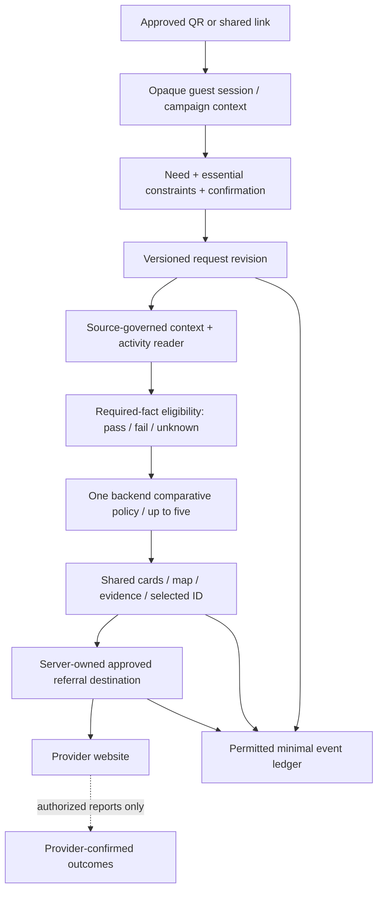

# CitySense contextual commerce architecture gap plan

Date: **2026-10-14, Asia/Tbilisi**. Status: **assessment/proposal only**. Scope: minimal architecture for contextual tourist discovery, defensible comparison, approved provider redirection and later small-hotel distribution. This document authorizes no implementation, account, data collection, payment, map stage, Git mutation or publication.

Evidence references E01–E32 resolve to exact current paths and line ranges in [the codebase audit](CITYSENSE_CODEBASE_READINESS.md#2-evidence-index). [Founder handoff](CITYSENSE_TECHNICAL_READINESS_HANDOFF.md) summarizes decisions. Preserve the modular monolith, frozen B0/replay and research protocol, private Telegram cap, `/v1` search semantics and organic order/hash. Resolve affected CF-01/02/03/08 decisions through approved contracts; this new product assessment does not resolve them by implication.

## 1. Assessment A — existing reusable assets

| Asset inspected | Minimal reuse | Boundary / necessary change |
|---|---|---|
| Strict Pydantic contracts/finite values/aware timestamps | Reuse validation conventions and error redaction | Add separate approved tourist models; do not append unsupported fields to legacy contracts. E01/E08 |
| One IntelligenceService and REST boundary | Reuse composition, transaction/error patterns and backend-only decisions | New guest-safe purpose/session access plus approved recommendation endpoint/retrieval semantics. E06–E09 |
| Evidence and source metadata | Reuse provenance, issue/valid/retrieved chronology, license/purpose/caching rights | Business facts need typed categorical/quote/slot evidence, revocation and expiry. Numeric fractions cannot represent child eligibility. E01/E10 |
| PostGIS and geometry history | Reuse stable identity, WGS84 storage, as-of point revisions and radius operations | Verify entrances/meeting points, provider product-place mapping, deduplication; no existing route graph. E04/E05/E13/E14 |
| Deterministic scorer and explanations | Retain protected research behavior and reuse fail-closed coding patterns | General tourist comparison needs simple independent eligibility and preference policy in the same backend, without duplicating a client scorer or silently modifying B0. E02/E03 |
| Map cameras, native navigation, diagnostic controls, attribution | Reuse renderer/worker setup, tested camera behavior and lawful branding seams | Build results/selection overlays only after product visual/map approval; separate diagnostics from guest UI. E20–E23 |
| Normalized source adapter, retry/cache/byte limits | Reuse bounded transport patterns and lineage validation | Implement actual authorized mappings; source-specific quote/cache/availability policy differs from environmental snapshots. E10–E12 |
| ProviderEntity/Offer/OpportunityReader | Reuse verified-versus-discovered/availability semantics | Additive activity model and concrete readers/referral capability; no existing working provider connector. E15 |
| Private Telegram REST adapter | Preserve as a bounded developer/private demonstration interface | Do not extend it or put it on the delivery critical path without separate scope. E17/E18 |
| LANDING-WEB source, truthful status and photo provenance | Reuse corporate positioning/disclosures and site deployment-readiness separation | Finish already authorized site QA separately. Its six pages and CSS are not an approved tourist application design system. E24–E26 |
| Offline tests, generated contracts and CI lock recipe | Reuse repeatable checks/negative fixtures/contract drift | New guest/eligibility/map/provider tests and physical QA still required; DB tests mutate a disposable schema. E27–E30 |

## 2. Minimum target architecture

One FastAPI modular monolith, the existing PostgreSQL/PostGIS installation pattern, one guest web client and **at most one actual authorized supply strategy** at first. No microservices, general agent framework, vector database, multi-city platform or hotel SaaS is justified by inspected demand/load evidence.



Every node beyond existing backend primitives is proposed/unbuilt. The site remains a separate corporate entry surface; the new journey must not inherit its visual approval or appear live in the current landing illustration.

### Request, constraints and state

Use an approved additive request representation with:

- `request_id`, monotonically increasing `revision`, city `batumi`, confirmed need/interest and language.
- Party: adult count, child count and only the age bands/ages necessary for the chosen activity rules; clarify an unspecified child's age when it affects eligibility. Keep this ephemeral by default.
- Hard constraints: total group budget with currency, start/window/return deadline with timezone, duration/free-time ceiling, required mobility/access/safety conditions and user-confirmed scope. Soft preferences belong in a distinct field.
- Origin/accommodation return point explicitly supplied or consented, transport mode and any maximum walking limit. No silent geolocation or claim that a hotel referral code identifies an exact room/location.
- Evidence/quote references and request time; unsupported or unconfirmed essential requirements remain explicit unknowns.

Natural language may produce a **proposal** for these fields later. The first experiment should use structured input and visible confirmation. A model cannot create a price, itinerary, safety condition, route or availability fact. Required parser acceptance includes party preservation, currency/amount/total-price meaning, relative-time resolution and clarification rather than silent defaulting. No OpenAI integration is necessary to prove the rules first.

Cards, map, chat if later approved, evidence panel and referral selection share `{request_id, revision, activity_id, entrance/meeting_point_revision, evidence_version, selected_id}`. Changing constraints invalidates the old result/action set. Reject late responses for older revisions; preserve correct identity during sorting and pin overlap. A result URL from an old shortlist must not bypass a new eligibility check. There is no corresponding implemented shared state today (E24/E22).

### Eligibility before comparative relevance

For each **required** fact, store `satisfied`, `violated` or `unknown` with evidence reference and expiry. An unknown required safety/access fact cannot pass. Failure produces an explicit reason. Unknown requirements hold the activity out of the eligible shortlist; a separate clearly labeled unresolved view may explain what is missing without presenting it as eligible.

The three-hour scenario needs full-trip feasibility:

```text
outbound travel + check-in/wait + activity duration + return travel + stated buffer
    <= free-time window
and projected return <= visitor's fixed return deadline
and party-specific total known price <= visitor's total budget
and verified group/age/access requirements pass
```

Unknown duration, departure slots, group charges or route/return time cannot be treated as zero. A regional weather sample is context with uncertainty; it cannot certify site safety. Availability is request/date/party-specific and must expire. An affiliate destination page without inventory access cannot satisfy a hard availability condition.

After eligibility, simple documented preference match and relevant comparison attributes can order alternatives; use stable deterministic tie behavior, request-appropriate diversity and user controls. Present up to five defensible results, without padding or hard-constraint relaxation. Explain tradeoffs rather than asserting objective optimality. Keep organic policy/version/hash separately identifiable. Sponsored priority stays inactive pending CF-02.

### Retrieval and coverage

Keep current `/v1` search intact (E05). Seek Founder approval for an additive endpoint or `/v2` compatibility choice under CF-03. Its policy should define supported source/city/interest coverage, deduplication, search/time/cost bounds, termination reason, excluded/unknown counts and incomplete/truncated coverage. Acquire enough appropriately bounded candidates **before** eligibility/selection; do not take first five IDs or Telegram's first three as the recommendation universe. More retrieval is not automatically better: scope it to the user's activity/window and lawful inventory. Define independent retrieval acceptance on fixtures plus permitted actual inventory, without inventing a numerical recall threshold.

### Context engine

Start with request time, origin/return location, verified activity facts, authorized weather if the chosen task needs it, and a routing source only where time feasibility needs one. Each context field carries kind, source, observed/valid/retrieved time, method, rights and uncertainty. Expose unavailable/stale/denied context. Use source-specific caches only when permitted, never relabel stale data as live.

The existing Open-Meteo parser has null issuance and is outside historical replay (E12). A future tourist forecast contract may explicitly allow retrieved forecast context with that caveat, but must not weaken protected issued-time research semantics. Rain/storm/exposure policy and commercial feed access are separate missing pieces. The existing fixed public endpoint also lacks the commercial customer-key mapping. Avoid bolting weather onto greenery scores as a surrogate for thermal/child safety.

Routing must carry transport mode, origin/destination entrance, departure/target time, provider/version, duration/distance, assumptions, route validity and access uncertainty. Caller minutes remain caller estimates; they cannot guarantee return-to-hotel timing. If the pilot task cannot obtain defensible route facts, constrain the approved task or abstain rather than promising deadline compliance.

## 3. Minimal provider/activity schema proposal

This is a field proposal, **not a migration or executable schema**. Add approved models around E15 instead of replacing evidence/research/place contracts.

| Field group | Minimum content | Honesty/security rule |
|---|---|---|
| Identity | Internal activity ID; provider ID; provider product ID; city; source version; optional linked place ID | Provider product, supplier and place IDs remain distinct; deduplicate without losing provenance |
| Description | Title, category/interest tags, supplied language | Untrusted provider text is plain data, never executable HTML/tools or model instruction |
| Geography | Verified or source-reported activity/meeting point/entrance; point revision; verification state | Do not label OSM boundary vertex as entrance; point-only initial scope is sufficient |
| Duration/time | Optional duration/range, operating schedule and dated slot references | Missing is null; schedule is not proof of available capacity |
| Price/quote | Optional amount/currency, basis (`from`, per-person or group-total), party/date/options, fees/inclusions, checked/expiry and source | Starting price is not the group's budget check; no unsupported currency conversion |
| Party/access eligibility | Supported counts/age bands/required access facts and evidence states | Unknown required facts prevent eligibility; provider claim distinct from independent verification |
| Availability | Unknown/unavailable/reported/confirmed; party/date/slot scope; verification method, checked/expiry | Referral-only reader always returns unknown, not inferred available |
| Provenance/rights | SourceMetadata-compatible flags, terms/review reference, retrieved/last verified, permitted output/caching, revocation status | Rights are reviewed records, not fabricated permissive booleans |
| Destination | Server-owned destination ID; validated permitted HTTPS booking/referral URL; last verification and current permission status | No caller-supplied arbitrary destination; offline URL shape does not establish reachable provider product |
| Attribution | Provider/link policy ID; opaque subID/campaign permission; configured affiliate account reference kept server-side | No raw prompt, age, precise location, room number or personal identifier in subIDs |
| Capability/status | Catalog, quote, availability-read, referral, report-import capabilities plus errors/coverage | Link capability and inventory capability are separate; no inferred booking-confirmation action |

Minimal provider boundary: `capabilities()`, `search_activities(request_scope)` if authorized, `get_activity(product_id)`, optional `quote_or_availability(product_id, date, party)` if genuinely supported, and `approved_referral_destination(product_id, attribution_context)`. Do not force a referral-only adapter to implement fake availability methods. Return typed unavailable/denied/rate-limit/stale/partial outcomes and rights. Start with one fixture or reviewed manual-inventory implementation; add a second provider only to solve observed supply coverage, not to complete an abstract framework.

An affiliate partner identifier authorizes only the terms and capabilities actually granted. Public Viator documentation distinguishes higher inventory/booking access needing approval/certification; GetYourGuide documents separate teaser/reading/booking access requirements. [Viator access levels](https://partnerresources.viator.com/travel-commerce/levels-of-access/), [GetYourGuide API requirements](https://partner.getyourguide.support/hc/en-us/articles/13981133907613-API-integration-and-requirements). The repo has no account approval or current inventory capability for either. Direct authorized links can support referral without rebuilding an OTA; they cannot prove current availability or price.

## 4. Small-hotel distribution and analytics

Use one small server-maintained registry, not a hotel-admin SaaS:

| Proposed record/module | Minimal purpose |
|---|---|
| DistributionPartner/Campaign | Stable hotel/placement/campaign ID, confirmed placement permission, allowed entry route, status, approved branding reference |
| GuestSession | Opaque random ID, server-bound campaign, start/expiry, policy/consent state and optional approved access grant; no precise room identity by default |
| RequestRevision/Selection | Constraint-confirmation state, versioned shortlist identity, eligible selection and minimal outcome reference; retention managed separately from research |
| ReferralDestination/Click | Server-owned approved URL/policy, session/request/candidate association, provider and permitted opaque subID; duplicate/idempotent event handling |
| PilotEvent | Approved names/version, timestamp, random session, campaign, revision, permissible coarse properties and retention expiry |
| ProviderOutcome import | Optional authorized report/order reference, matched opaque subID, status/amount/currency only when supplied, reversals and provenance |
| AccessGrant | Only if chosen: free/hotel-funded time-limited grant or manually issued entitlement; paid-grant transition waits for a separately approved business model |

QRs point to approved campaign entry links; a copied public QR may attribute an arrival but cannot prove hotel occupancy or payment. Sign/access-bound entry tokens only if access entitlement needs them, and avoid bearer tokens in logs. Unknown campaign inputs must never confer privileges or select arbitrary redirect domains. Hotel-funded access does not imply implemented hotel billing.

Propose a limited funnel for privacy/product review: entry/start, confirmed request, shortlist rendered, compared/detail/map focus, eligible selection, provider referral click. These are observable application actions once instrumented. Provider-confirmed booking/fulfillment or commission may be recorded only from authorized provider evidence. No browser redirect can establish that a visitor bought, attended or enjoyed an activity. Self-reported action remains a separate class; protected research ratings remain separate too.

Consent/notice/lawful-purpose determination, expiry/deletion, withdrawal handling, cross-border recipients and location processing need FA-04/CF-08 review before real collection. Research consent flags in E31 do not authorize tourist analytics. Do not insert analytics pixels as a substitute for approved measurement design. Anonymous-to-the-UI random sessions may still be pseudonymous processing; avoid claiming unconditional anonymity.

Until the revenue model is approved, report permitted usage/clicks only and keep access free or explicitly scoped funded/manual. Ten GEL is a test hypothesis, not a default price. Revenue/commission accounting needs provider reports, agreed attribution windows, currency/source references, duplicate prevention and cancellation/reversal events. Start with a reviewed report import if granted; no generalized payment, payout, refunds or hotel invoicing platform is necessary for the first informational/referral pilot.

## 5. Assessment B — missing core capabilities, ordered by dependency/value

| Order | Required work / customer outcome | Depends on / completion evidence |
|---:|---|---|
| 0 | Choose one Batumi tourist task, supported required constraints, scope/languages and information-only versus affiliate continuation | Founder scope/budget; separate product/research instrument; honest no-data boundary |
| 1 | Permissioned inventory and entity/entrance facts | Reviewed rights/publication/cache/LLM transfer if used; independently reviewed required-fact coverage; dated usable candidate records, unknowns and freshness |
| 2 | Additive tourist request/eligibility/retrieval contracts and minimal activity model | CF-03/version decision; category/group/budget/window/access semantics; negative/unknown cases; preserve all legacy exports |
| 3 | Offline deterministic constraint experiment | Approved experimental implementation scope; synthetic fixture outcomes independently reviewed; no provider accounts or map UI required |
| 4 | PRODUCT-APP interaction/visual reference approval and map prerequisites | Explicit UX-0–4 phase permissions; lawful visuals; Stage 1B closure/waiver before map-style sign-off; LANDING-WEB acceptance excluded |
| 5 | Guest-safe backend + minimal request/session/context retrieval | Approved access/privacy/source purpose and retention; no browser operator key; revision/race/denial tests |
| 6 | Integrated mobile input, clarification, alternatives/cards/map/evidence/selection | Approved UI and engine/service contracts; keyboard/touch/physical-mobile QA, correct entrance identity and fewer/no-options cases |
| 7 | Authorized referral destination and provider-specific link policy | Actual affiliate/deep-link permission, useful Batumi supply, verified permitted destinations, opaque attribution rules; no inventory overclaim |
| 8 | Permitted event/attribution ledger and observed funnel | Approved instruments/purpose/retention; distinct click/selection/provider-confirmation outputs; reports only if granted |
| 9 | Public/supervised hosting/support/deployment verification | HTTPS/gateway/least privilege/secret policies, fresh dependency audit, DB/backup/restore/load smoke tests, support/no-go procedure and Founder review |
| 10 | Small hotel entry registry and chosen access policy | Actual QR placement/distribution agreements, event privacy, permissions for branding/incentives, campaign/session tampering tests |

Inventory/retrieval/privacy/UX are dependencies, not subtasks that can be skipped because backend tests pass. Optional paid access and partner-confirmed reporting can remain out of scope if the selected pilot outcome is informed choice plus approved referral clicks.

## 6. Security and deployment work required before real users

Preserve research isolation. The current dev legacy replay path authenticates only when an operator key is configured, and replay UUIDs lack guest/source-publication ownership (E08/E09/E14). A public guest frontend needs a narrow server-controlled session service and reviewed commercial/publication purpose, never the current research operator key in a browser.

Add an approved deployment envelope: HTTPS, explicit production mode, allowed hosts/origins, ingress connection/body-read deadlines, trusted proxy policy and appropriate cross-worker rate limits; least-privilege DB roles, backup/restore, source expiration/revocation and operational monitoring. Do not copy the DB-only Compose file or loopback preview servers into a production hosting claim. Current CORS absence is restrictive, not a permissive configuration, and cross-origin product access would need deliberate design.

Use separate retention-managed guest/event/provider records alongside immutable research evidence. Enforce denial for stale/withdrawn/unauthorized sources in every client. Close the Stage 1 unfiltered MapTiler configuration path before reusing that host (E21), while treating properly restricted browser map keys as intended public credentials. Validate provider descriptions/URLs as untrusted data; no prompt/tool execution. Check fresh Python and JS dependency advisories during an approved release review; historical zero-findings receipts are insufficient.

No generic multi-tenant IAM, payment processing, full booking lifecycle or public MCP adapter is needed to prove initial guest selection/referral value. Future actions require separate consent, identity, idempotency, capacity, callback and cancellation design. Booking request, provider-confirmed booking, fulfillment and commission are separate states.

## 7. Assessment C — defer or isolate

- **Research/sensing:** preserve B0/A1/B1 tooling and environmental evidence, but isolate it from tourist relevance/commerce milestones. No novel comfort ML, embeddings, sensing deployment, city heatmaps, 3D digital twin or second-city rollout before a validated need and permitted data.
- **Synthetic evidence:** keep engineering fixtures/FakeProvider/FixtureClient clearly labeled and separated from live inventory. Retire their use as proof of live capability, not the tests or source files.
- **Legacy SQL and rejected prototypes:** preserve archives and the legacy proposal; active migrations remain Alembic. No restoration/deletion/reimplementation based on archived filenames.
- **Provider breadth:** defer four simultaneous OTA integrations, direct booking, weather/routing redundancy, general service-area/digital schema framework and partner dashboards. One real supplier capability plus honest fallbacks is more valuable.
- **Monetization complexity:** defer guest checkout, hotel subscription billing, payouts, refunds, revenue sharing and automated reconciliation until the business model, actual permissions and measurable demand exist.
- **Agent distribution:** preserve in-process tool catalog and shared service, but defer public OpenAPI/MCP release, agent writes and concierge automation until tourist value, rights and authentication are accepted.

## 8. Milestone estimates for one Founder using AI-assisted development

These are **planning estimates**, not vendor quotes or guaranteed schedules. Low/base/high assumes roughly 35 focused developer-hours per week, an existing competent Founder, independent review availability, one limited Batumi task, one supply path and no payment processing. Time includes engineering verification/documentation; inventory review and external gate waiting are separately identified. Revisions from Founder/UX reviews and missing source facts can dominate elapsed time. No work is auto-authorized by these estimates.

Developer-hours below are **incremental** per milestone; cumulative totals are shown. Direct cash is a provisional USD budget excluding the Founder's unpaid labor, taxes/FX, commercial commissions, incorporation/legal engagements, devices not already owned and supplier-specific account fees or negotiated minimums. No supplier price or subscription eligibility is assumed. Optional external legal/data review is a separate quote-required line. Do not convert these allowances into GEL or expected revenue without current assumptions.

| Milestone | Incremental developer-hours low / base / high | Cumulative hours low / base / high | Direct setup/testing cash allowance low / base / high | Recurring monthly operating allowance low / base / high |
|---|---:|---:|---:|---:|
| M1: contextual demonstration | **80 / 150 / 250** | **80 / 150 / 250** | **$0 / $75 / $250** | **$0 / $0 / $50** |
| M2: authorized affiliate pilot | **130 / 240 / 400** | **210 / 390 / 650** | **$50 / $250 / $800** | **$30 / $100 / $250** |
| M3: small hotel distribution pilot | **50 / 100 / 180** | **260 / 490 / 830** | **$20 / $100 / $350** | **$0 / $25 / $75 additional** |

Ranges are resource allowances, not researched exact prices. M1 can have zero marginal cash with pre-owned hardware, offline fixtures and permitted local map resources; even static screenshot rights must be respected. M2 allowance covers a small host/DB/backups/domain if later authorized, limited licensed map/weather/routing/model usage if chosen, and operational testing. M3 covers limited QR material, entry QA and session/event capacity. If minimum licensed feed costs exceed the allowance, replan or narrow scope; do not use a noncommercial endpoint commercially. Official [Open-Meteo access/pricing](https://open-meteo.com/en/pricing) and [MapTiler plan page](https://www.maptiler.com/cloud/pricing/) require a then-current plan/volume decision. The audit did not purchase or establish eligibility for any plan. A manual structured parser avoids model expense initially. Legal/source-rights/translation/field-review costs are unquoted and **excluded**; they can be material, so a live-pilot total cash commitment cannot yet be established.

### M1 — contextual demonstration

Reuse: validation/evidence patterns, deterministic rule conventions, fixed city/geometry fixtures, MapLibre/camera/attribution and existing offline tests. Missing: approved tourist model, fixture activity reader, eligibility/time/group-price rules, simple comparison policy, narrow mobile form/confirmation/shortlist/map/selection state. No affiliate or provider approval is needed **if all inventory/context is synthetic and map display rights are independently permitted**.

Base-hour allocation: scope/contracts 24; labeled fixtures/reader 16; deterministic eligibility/time/budget/comparison 28; integrated narrow client/map/selection 48; error/accessibility/race checks 20; documentation/independent review corrections 14 = **150**. Broader natural language, more languages or routes beyond fixture estimates increase scope.

Dependencies/blockers: separate experimental implementation authority; relevant PRODUCT-APP UX phases and any map integration scope; Stage 1B closure/waiver before styling sign-off; reviewer availability. Coding-only effort is roughly 2.3/4.3/7.1 weeks at 35h/week, **after** the prerequisite inputs, not from today. Gate waiting has no evidence-based fixed duration.

Tests/completion: representative party/budget/deadline preserved; deterministic verified/fail/unknown cases; no-data/fewer-than-five/stale evidence; reverse-trip checks; map/card identity and revision races; keyboard/touch checks and independently reviewed physical views. Result must visibly state synthetic data and distinguish estimates. No live availability/booking or deployment claim.

### M2 — authorized affiliate pilot

Reuse M1 plus source metadata/HTTP retry/limits, stored evidence service and PostGIS identity. Missing: independently verified permitted inventory/entrances, actual provider/link capability, request-scoped quote/availability where supplied, required weather/routes where needed, guest-safe session/auth, approved event/referral ledger, hosting/operational support and independent release checks.

Base-hour allocation: approved inventory and source mapping engineering 40; provider capability/normalization/freshness 40; referral/destination/attribution 28; guest/session/privacy boundary 36; production envelope/backups/monitoring 36; negative/end-to-end/device/provider acceptance and review corrections 44; operational packet 16 = **240**. Independent field/legal collection outside engineering and unavailable provider APIs add separate effort/cost.

External approvals: actual affiliate acceptance and authorized links/attribution; permitted content/cache/display; lawful inventory/forecast/routing data; privacy/measurement instruments; approved hosting/release/PRODUCT-APP gates. Referral-only scope can avoid live availability **only if the approved task does not require it and the UI explicitly reports it unknown**. It cannot honestly complete a hard availability requirement in the representative request.

Partner/account/review waiting: **unknown and potentially indefinite**; public eligibility docs cannot estimate acceptance time or usable Batumi supply. Coding-only additional effort roughly 3.7/6.9/11.4 weeks, with total M1+M2 roughly 6.0/11.1/18.6 weeks at 35h/week after decisions. No production-date promise.

Tests/completion: approved actual task yields defensible comparisons, one genuine approved destination can be selected and clicked without leaking guest facts; exact link-building/provider rules are verified without unauthorized production transactions; attribution identifies permitted session/campaign/click only; blocked/stale/unknown data and outages are honest. Current quotes/availability only if authorized evidence exists. HTTPS/DB roles/backup restore/security/device checks and Founder release review pass. Confirmed bookings are not a required deliverable if reports are unavailable; do not invent them.

### M3 — hotel distribution pilot

Reuse M2 guest/referral/events and one deployment. Missing: a small hotel/campaign registry, permissioned QR entry, optional approved branding, session source binding, chosen free/funded/manual entitlement, permitted aggregate usage exports and field/support procedure. Avoid self-service admin onboarding.

Base-hour allocation: campaign/QR registry 18; session/access/context binding 24; reports and data retention 20; security/entry/mobile/device checks 22; pilot support/review packet 16 = **100**.

External approvals: actual hotel/placement/branding/distribution permission and participant/access rules; no apartment/occupancy/recruitment assumptions. Guest-paid access and provider commission reconciliation are **not included**: they need a chosen business/payment model, actual reporting grants and additional quoted engineering/operational scope.

Hotel/field waiting: unknown; no acceptance or occupancy evidence. Coding-only additional effort roughly 1.4/2.9/5.1 weeks; total M1–M3 roughly 7.4/14.0/23.7 weeks, excluding all waiting. The November target is not validated by this estimate.

Tests/completion: each approved hotel's QR enters correct campaign; copied/altered/unknown codes do not confer extra access; session/report boundaries and event retention work; multiple real physical mobile browsers complete the approved journey; Founder reviews actual deployment/support/readiness evidence. Provider revenue is reported only when independently sourced and reversals can be reconciled.

## 9. Smallest next technical experiment

Propose a **12–20 developer-hour offline constraint comparison**, scoped separately for approval. Deliverables would be an additive proposed request/activity contract, 6–8 synthetic activities and an executable deterministic eligibility table for the exact three-hour/two-adult/one-child/budget/return scenario. Required cases:

1. Known compatible party, total price, duration and full trip → eligible.
2. Exceeded monetary group budget → excluded, even if preference match is high.
3. Return after fixed deadline → excluded, even if outbound travel alone fits.
4. Child age/access requirement unknown → held as unknown, never passed.
5. Missing duration/quote/route or expired fact → fewer/no alternatives.
6. Seven or more eligible fixtures → at most five defensible alternatives with explicit coverage/tie policy; no fabricated padding.

Use structured confirmation, not a model, map capture, affiliate link, DB migration or new public endpoint. Preserve old contracts/exports/parameters/tests. Independently review fixture truth and required-fact outcomes before Founder review. The experiment establishes whether the **decision contract** can express and faithfully enforce the visitor job; it does not establish live inventory, field accuracy or pilot readiness. A later interactive map experiment requires its own approved UX/map scope.

## 10. Decision-oriented delivery boundary

Current completed work: audit inspection, offline checks and three Markdown reports. Application before/after: unchanged. No public demo URL, new visual captures, code implementation, source rights grant or release approval accompanies this plan. Existing corporate output remains local and its advertised test command fails. No independent agent QA was performed on this audit; external implementation/release QA remains a later required gate.

Recommended Founder decisions: choose the first supported tourist task and required facts; decide information-only versus approved referral scope; authorize the bounded offline contract experiment if desired; separately reconcile existing landing implementation QA/ledger records. Any implementation ticket needs exact stage/artifact/scope, reviewed contract/version and one-writer lease. At that later point use the repository handoff template and independent QA before Founder review. Audit completion never authorizes M1/M2/M3 execution.
