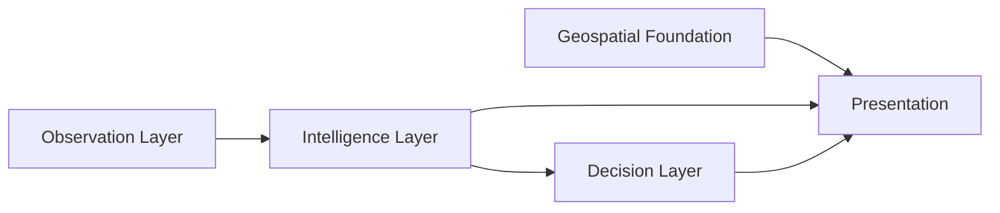

# Digital Twin architecture

10 October 2026, Asia/Tbilisi. Dedicated local visual prototype in `apps/digital-twin`.
The two current user attachments authorize this interface and supersede the earlier map-only
Stage 1 scope. They do **not** authorize Stage 2 backend, production SaaS or public deployment.
Actual volumetric Batumi rendering remains unverified; implementation is not visual acceptance.

## Repository basis and boundaries

Inspected existing Sprint 3 report, architecture/data contracts/OpenAPI exports, Stage 1/1B
design/evidence/preservation and Stage 2 readiness, existing map harness and camera receipts.
The retained foundation is a FastAPI/PostGIS modular monolith with a frozen, unvalidated
deterministic suitability engine and protected research protocol. Those implementations and
their exported interfaces remain unchanged. No unrelated web-demo code was located or reused.
No `.git` metadata exists here; preservation uses file digests, not an inferred clean Git status.

This prototype makes no CitySense API requests. It cannot expose operator keys, partner
availability, restricted research locations or prospective research polygons. Existing city
publication policies, operator authorization, response bounds and absent CORS are not bypassed.
No routing, live observations, forecast, opportunity or suitability API is fabricated.

## Five independently bounded layers

| Layer | Current implementation | Input/output boundary |
|---|---|---|
| Geospatial Foundation | `geometry.mjs`, retained OSM cameras/receipts, live supplier style/vector sources | WGS84 lon/lat; native building geometry; transient inspection; height provenance independent of demo score |
| Observation | `observations.mjs` | Five hypothetical node descriptors; deterministic time-stamped aggregate records; status, units, null gaps, source, quality, unknown uncertainty |
| Intelligence | `domain.mjs` | Pure profile-configured normalization, numeric aggregation, paired-node baseline comparison; no map SDK, DOM or protected engine import |
| Decision | `decision.mjs` | Pure synthetic action-review/report workflow, time-bounded before/after comparison; no action execution, causal model or backend writes |
| Presentation | `app.mjs`, `map-scene.mjs`, `camera.mjs`, `i18n.mjs`, HTML/CSS | Map interactions, inspector, native SVG history, timeline, quality/locale controls; display consumes numbers, not sector-specific scoring logic |

The map receives a frame of node coordinates, identifiers, numeric index/null and synthetic
flags. It does not calculate business metrics or average colors. Provider buildings are contextual
display geometry, not an analytics database. Fixtures can later be replaced by an authorized
observation adapter with the same timestamps/units/provenance semantics.

## Configurable analytical applications

| Template | Metrics and arbitrary demo weighting | Demonstration decision | Evidence limit |
|---|---|---|---|
| Public-space intelligence | Occupancy 0.5, movement 0.3, dwell 0.2 | Inspect access / hypothetical wayfinding investigation | Not visitor satisfaction, stress or infrastructure capacity measurement |
| Commercial operations | Occupancy 0.4, dwell 0.4, movement 0.2 | Inspect a possible bottleneck / hypothetical queue trial | No sales, staffing-cost or efficiency outcome evidence |
| Urban research/planning | Noise 0.4, temperature 0.3, PM2.5 0.3 | Corroborate/calibrate / hypothetical sampling plan | No measured environmental state or validated intervention effect |

Each profile declares metric keys, weights, a rise threshold and action options in `applications`.
The same buildings, node geometry, timeline and renderer serve all three. Configuration is
an extension seam, not a customer-demand finding or production alerting system. There are
no per-person trajectories, identifiers, inferred emotions or validated demand/willingness-to-pay claims.

Normalization clamps configured synthetic ranges to 0–100; ranges are visualization choices,
not clinical, safety or scientific thresholds. An index requires at least 66% of configured
metric weight. Available nodes receive equal weight in city/zone aggregation; coverage and
denominator remain explicit. Baseline comparisons match the same nodes with current and
historical primary-metric data. No confidence interval or significance is implied.

## Operational workflow and future seams

Current path: select zone → inspect measurements/status/source → see primary-metric rise
and timestamp → compare prior-day baseline → review a listed possible action → export own
synthetic evidence/report. The pure workflow is exercised by tests; browser interactions are
pending. Before/after output is hidden until the simulation cursor includes its after-period;
absence of a control group prevents causal attribution.

Descriptors carry `organizationId`, `siteId`, node/zone IDs and schema version for future
multi-organization/site adapters. Metric/profile/rule configuration can become authorized
customer configuration. Reports have explicit provenance, aggregation, comparable-node set,
time window, uncertainty and `actionExecuted: false`. Future alert review, intervention ledger,
server-issued access scope, dashboard preferences and subscriptions require separately
authorized backend contracts and validation; no auth, billing or SaaS backend is implemented.

Opportunity Registry locations, published suitability outputs, authorized partner inventories,
walking routes/isochrones and environmental observation/forecast adapters could feed separate
owned overlay sources. Each needs independently licensed geometry, timestamp/expiry, units,
authorization/publication rules and bounded response semantics. Supplier tiles must not become
the routing graph or proprietary inference input. Suitability remains labeled unvalidated and
cannot be silently replaced with this unrelated demo index.

## Local hosting and maintenance

Pinned MapLibre 6.13.0 in an isolated npm manifest/lockfile; no React, Three.js, deck.gl, Turf,
charting, build-time bundler or new backend dependency. Python stdlib host allowlists exact
assets and public-key config on 127.0.0.1. Style/tiles/glyphs/sprites are requested directly
from MapTiler; no tile proxy, service worker, offline storage or persisted provider geometry.
Themes mutate runtime paint while preserving provider label/font/sprite/source definitions.
Provider revisions remain live: diagnostics record style hash and SDK, not a permanent copy.
SDK upgrades and provider schema changes require explicit revalidation, not blind dependency drift.

See [coverage](BATUMI_3D_DATA_COVERAGE.md), [visual system](DIGITAL_TWIN_VISUAL_SYSTEM.md),
[performance](DIGITAL_TWIN_PERFORMANCE.md) and [validation](DIGITAL_TWIN_VALIDATION_REPORT.md).
