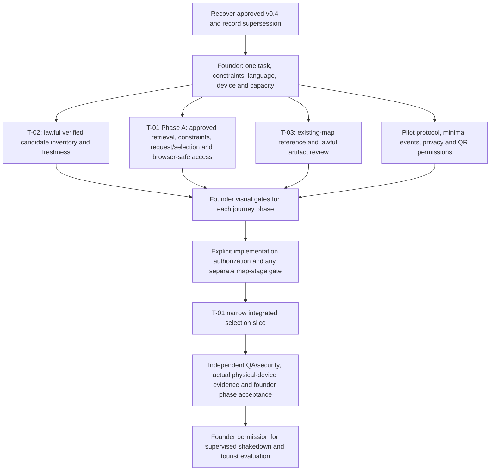

# CitySense Chief Engineer orchestration acceptance report

Date: 2026-10-10 (Asia/Tbilisi). Overall classification: **PARTIAL**.
Session scope: operational read-only product audit and additive acceptance documentation only.
No implementation, contract edit, new UI/map stage, provider activation or deployment is authorized.

## Result and source boundary

The live multi-agent audit workflow ran: five real workers inspected different seams of the same complete journey,
returned bounded handoffs and were integrated by Chief. This establishes operational delegation, not product readiness.

Required Blueprint v0.4 was not located in the repository, Downloads or inspected attachment Markdown/text sources.
The repository charter/register/source copies still identify v0.3. Chief asked for the v0.4 local path; it remains unresolved.
v0.3 was read as the available approved historical source, not relabelled as v0.4.
The current user's target journey governs this audit; v0.4 conformity and any new/superseding decisions cannot be certified.
These proposals must be checked against the actual approved v0.4 before adoption.

Native named-profile selection is not available in the current spawn tool. Workers read and applied the corresponding
role TOML/Markdown instructions portably. Zero native named-profile launches are claimed.
Context isolation was exercised with fork_turns=none; all workers shared the filesystem.
Read-only behavior is checked through handoffs and preservation hashes, not proven by OS/worktree isolation.
Existing aggregate visual gates do not demonstrate founder approval at every UI/UX phase.
No actual integrated journey screenshot/prototype or physical-device acceptance closes those gaps.

| Acceptance dimension | Classification | Evidence / limit |
|---|---|---|
| Actual bounded delegation and role handoffs | PASS | Five spawn_agent calls; six role layers across five workers |
| Whole product goal retained across specialists | PASS | Every assignment carried full journey; Chief retained all seams and long-term action boundaries |
| Chief integration and independent review | PASS | Independent QA reviewed Chief drafts; Chief applied its permission/relevance corrections and retained limits |
| Observed read-only task/context isolation | PASS WITH LIMITS | Separate contexts; all 443 preexisting visible files byte-preserved; shared filesystem without enforced OS/worktree isolation |
| Approved v0.4 source reconciliation | PARTIAL | Source not located; no presumed supersession |
| Native configured-profile loading | PARTIAL | Portable instructions applied; named loader unexercised |
| Every-phase visual approval verification | PARTIAL | Aggregate gates exist; explicit phase records and actual artifacts missing |
| Implemented tourist journey readiness | BLOCKED | No integrated PWA; real evidence gives zero scored recommendations |
| Stage/contract/implementation boundaries | PASS | No preexisting file changed; only nine authorized acceptance documentation/evidence files added |

## Actual invocation, ownership and handoffs

Chief exclusively owns the new report/evidence files; workers own no write paths.
All five were fresh short-lived agents with fork_turns=none and inherited model settings.
The first wave used three workers plus Chief; after completed handoffs released slots, Platform and QA were invoked.
No more than three workers ran simultaneously; no settings/features/worktrees were changed.

| Audit | Actual runtime agent | Profile instructions applied portably | Chief integration |
|---|---|---|---|
| OA-PRODUCT | /root/acceptance_product | product_research | Separate pilot/research; preserve full T-01 journey; positive comparison and honest failure evidence |
| OA-GEO | /root/acceptance_geospatial | geospatial_data | Lawful task inventory, entrance meaning, freshness and publication gates precede shortlist |
| OA-VISUAL | /root/acceptance_visual | cartography + mobile_pwa | Explicit phase approval/artifact records; qualitative/strict/physical-mobile evidence separated |
| OA-PLATFORM | /root/acceptance_platform | platform | Existing private read contract versus proposed request/retrieval/selection seam |
| OA-QA | /root/acceptance_qa | qa | Independent cross-component evidence and Chief report review |

[Invocation ledger](evidence/orchestration-acceptance/INVOCATIONS.json) records actual calls, mode, profile hashes
and returned handoffs. Chief-normalized handoff records retain checks, limitations and integration decisions:
[Product](evidence/orchestration-acceptance/OA-PRODUCT.md),
[Geospatial](evidence/orchestration-acceptance/OA-GEO.md),
[Visual/Mobile](evidence/orchestration-acceptance/OA-VISUAL.md),
[Platform](evidence/orchestration-acceptance/OA-PLATFORM.md),
[QA](evidence/orchestration-acceptance/OA-QA.md).
They are recordings of live worker reports, not worker-authored files or independent runtime attestations.

## One dependency graph

Every node is an approval/readiness dependency, not permission to advance. Parallel reviews do not bypass shared contracts.

Commercial-priority activation is outside this critical path and stays inactive.
Actual partner contacts/actions require separate rights/authority/consent gates; no-action selection remains valuable.
eSIM activation, driver booking, payments, external agent writes and multi-city rollout remain deferred.
A1/B1 research retains its separate protocol; no research accuracy claim closes a product gate.

## Consolidated readiness and integration-risk matrix

| Journey seam / producer → consumer | Current implementation/evidence | Dependency / integration risk | Proposed acceptance evidence and owner |
|---|---|---|---|
| QR → mobile session | UNBUILT; 30 apartments only distribution opportunity | Placement, notice, recruitment, browser-safe access absent | Permissioned QR opens without install, minimum data, no operator key; Mobile + Security |
| Need → confirmed required constraints | Three research Need enums only; no tourist parser/clarification | Budget/time/access/hours facts and hard/soft semantics unbuilt | Approved narrow need/clarification flow with explicit unknowns; Product + Decision + Platform |
| Lawful candidate/evidence → eligible pool | Five boundary anchors, empty model features, four abstentions/one estimated-walk exclusion | No verified entrances/task coverage; publication uncleared/denied while narrow local research/cache is permitted; boundary point cannot become entrance | Assertion-level criteria/source/method/time/rights/refresh owner and independent checks; Data |
| Retrieval → up to five alternatives | /v1 rights-filtered radius search, stable-ID cutoff≤30, truncated/no cursor | CF-03: early cutoff is not coverage-aware recommendation retrieval | Approved wider reviewed pool policy before shortlist; recall/coverage and fewer/no-result cases; Decision + Platform |
| Alternatives → compare/refine | Exactly-two comparison endpoint delegates to shared suitability service | Five-card UI is unbuilt; pairwise API must stay exactly two; no client scorer | Pairwise comparisons plus honest shortlist, consistent revision/evidence; Mobile + Platform |
| Cards/chat/refinement → selected map/panel | Isolated Stage1C navigation; shared request/selection seam proposed | Wrong geometry, stale async responses, duplicated ranking, lost attribution | Correct supplied identity/geometry/evidence version, reduced motion, race/error/denial cases; Mobile + Cartography |
| Present evidence → validity judgment | Numeric evidence/freshness exposed; missing_features separate from staleness | Present-but-stale is not verified; score confidence is not calibrated probability | Fresh/verified/inferred/unknown/stale distinctions and required-criterion audit; Data + Research + QA |
| Selection → next-action understanding | Offering contracts only; no routes/ETA/booking runtime | Schema/bookable declaration or request mistaken for fulfillment | Supported/unavailable states, verified permissioned contact only if supplied, no invented ETA/confirmation; Integrations + QA |
| Selection → measured outcome | No approved product instrument or tourist field evidence | CF-01; denominator bias, duplicate starts, selection-as-arrival/satisfaction | Approved start/end/denominator, incomplete outcomes and independent criteria audit; Research + Security |
| Visual/device acceptance → phase advancement | Conditional desktop GOOD feedback only; strict/mobile artifacts not located | Aggregate approval substituted for phase-specific actual review | Artifact/build/device/language + dated founder record per phase; Cartography/Mobile + QA |

Evidence anchors: [coverage](../REAL_WORLD_DATA_COVERAGE.md), [Sprint3 end-to-end](../END_TO_END_ACCEPTANCE.md),
[retained DB smoke](../evidence/sprint-3/retained-db-smoke.json), [API contract](../OPENAPI_CONTRACT.md),
[platform](../../services/api/src/citysense/platform.py), [map report](../design/MAP_STAGE_1C_REPORT.md).
Historical executions are not current test reruns. Private raw geometry/contacts/credentials are not republished.

## Three explicit contract-conflict proposals

All three remain CR_DRAFT / FOUNDER DECISION PENDING. No contract has been amended.

### OA-CF-01: distinct product-pilot and protected research protocols

Conflict: available blueprint V-001/V-006 focuses on independently checkable constraint-valid selection;
[protected draft](../evaluation-protocol.md) primary question/ground truth/primary metric covers experienced-suitability
paired prediction with post-exposure labels. The draft is protected even though scientific sign-off is pending.

Options: (A) additive named product-pilot protocol, research retained; (B) explicitly amend protected research,
requiring scientific review and versioned change; (C) defer participant measurement.
Recommendation: A. Declare criterion/evidence-at-decision audits, eligible starts/exclusions, clock boundaries,
duplicate/restart handling and unknown/abstained/unfinished outcomes before instrumentation.
VDCR/TVD definitions, comparator and privacy remain proposed/unverified, not approved numeric success thresholds.
Founder decision: FA-01/04, protocol priority and scope. Compatibility: protected harness/B0/A1/B1 untouched.
Closure: dated approval, distinct protocol/denominator/privacy record, independent reviewer acceptance;
no transfer of research sample/accuracy claims into the tourist pilot.

### OA-CF-02: commercial priority stays inactive pending explicit presentation policy

Conflict: R-002 permits transparent priority among materially equivalent suitable alternatives;
[opportunity policy](../OPPORTUNITY_REGISTRY_DESIGN.md) forbids commission/attribution changing ranking,
and [ADR-0009](../adr/0009-agent-first-platform.md) excludes commission from organic ranking.

Options: (A) inactive commercial priority for the first slice; (B) founder-approved distinct disclosed presentation
policy with organic order/hash preserved; (C) explicitly amend core ranking prohibition.
Recommendation: A now; consider B later through a reviewed CR. Reordering displayed equivalents still affects
tourist experience and is not a loophole. No numerical equivalence tolerance is invented.
Founder decision: FA-05 plus evidence/equivalence/disclosure/review policy before any activation.
Closure for future activation: dated amendment, eligibility and original organic assessment/order preservation,
visible labels/audit and paid-inventory negative tests. Unresolved inactive priority does not block standalone value.

### OA-CF-03: additive coverage-aware recommendation retrieval

Conflict: R-009 disallows arbitrary early ID cutoff; [current /v1](../OPENAPI_CONTRACT.md) sorts stable IDs,
limits to 30 and has no cursor. platform.py search_places applies rights/radius predicates before ORDER BY p.id LIMIT,
then suitability evaluates the supplied candidates. Raising the caller limit alone cannot prove coverage.

Options: (A) additive approved recommendation-discovery contract over reviewed inventory with explicit coverage,
freshness and truncation policy; (B) /v2 replacement for breaking /v1 changes; (C) retain /v1 for private registry reads
and defer tourist recommendations. Recommendation: A while preserving /v1; use /v2 for any breaking field/semantic change.
No exact endpoint/schema is approved by this recommendation.
Founder decision: FA-06, retrieval/constraint/version path; Chief reserves shared schema edits.
Closure: approved producer/consumer contract, reviewed wider pool and ID-permutation/early-cutoff regression,
required-fact/rights/staleness/fewer-result tests; preserve existing pairwise comparison, exports and frozen replay.

## Every UI/UX phase: explicit founder visual gate

This task requires checking every phase. Existing documents supply aggregate human gates, not completed per-phase approval.
The following acceptance checklist makes missing evidence visible; it does not authorize prototyping, captures or implementation.
No phase is HUMAN_ACCEPTED. Any future phase advancement requires founder approval tied to real review material.

| Phase | Required concrete review material | Current state |
|---|---|---|
| 0 Reference/provider | Lawful actual map screenshots and inspectable named mobile reference/prototype with configuration | PENDING; provider provisional, actual artifacts not located |
| 1 QR/open | Actual landing/loading/notice/error screens or explicitly authorized interactive prototype | PENDING; integrated QR client unbuilt |
| 2 Need/clarification | Actual input/required-vs-soft/validation/unknown states or authorized prototype | PENDING |
| 3 Alternatives | Actual five/fewer/none/loading/stale/denied states or authorized prototype | PENDING; no invented fifth |
| 4 Compare/refine | Actual comparison/refinement/more-results/interruption states or authorized prototype | PENDING; pairwise API unchanged |
| 5 Selected map/evidence | Real lawful map rendering plus interaction review, supplied target, attribution, accessible motion and source/time panel | PENDING; isolated navigation feedback is insufficient |
| 6 Selection/next actions | Actual selection/available/unavailable/contact/request status screens or authorized prototype | PENDING; transactions remain separately gated |
| 7 Integrated mobile | Actual implemented journey and negative flows on approved physical devices, screenshots and independent QA | PENDING; emulation/prototype cannot close runtime/device acceptance |

Each record must identify phase, actual artifact path/stable prototype reference, revision/build/configuration,
device/language, rights/limitations, founder/date and accepted/rejected scope.
For design review, an interactive prototype may be acceptable only within explicit future authority.
For runtime map/device acceptance, real lawful rendering and implemented physical-device evidence are required.
A generic approval or final release decision cannot retroactively supply missing phase records.

## One proposed next implementation ticket: bounded T-01 refinement

Status: PROPOSED / BLOCKED, not TASK_READY. This refines existing T-01; it adds no fourth backlog dispatch.
Outcome: one founder-chosen tourist need near Orbi leads to an independently checkable comparison and informed selection.
Owner: Mobile PWA; Platform/Decision own approved backend seams sequentially; independent QA, Research, Security and Founder review.
Decision IDs: P-004/G-001, R-001/R-003–006/R-008–010, V-001/V-006, X-003/X-005.
Owned paths: unassigned until Chief grants an exclusive lease after contract/design readiness.
Read-only dependencies: approved blueprint, all accepted schemas/ADRs, frozen research core and existing map evidence.

Prerequisites: actual v0.4 review, FA-01–04/06/07/10, T-02 lawful task inventory and T-03 visual reference,
approved request/constraint/retrieval/selection and browser-safe access contracts; any map-stage authorization is separate.
Phase A remains contract/readiness review; future Phase B needs explicit implementation approval.
Do not assume quiet-rest research is the chosen tourist task, a free-text parser exists, or a simple map/abstention alone delivers selection value.

Proposed acceptance criteria:
1. Permissioned mobile QR opens without installation or privileged browser credential.
2. A founder-approved narrow need/clarification flow confirms required constraints; unknown safety/access never qualifies.
3. A reviewed lawful real pool supplies at least two defensible options for the positive comparison test.
   Five remains desired where supported; honest fewer/none is required, without invented/relaxed criteria.
4. One backend approved policy produces alternatives; preserve protected research and /v1 compatibility.
   Independently audit intent-to-attribute comparative relevance against the reviewed pool using an approved rubric;
   keep criterion validity, comparative relevance and UX efficiency separate, without superiority/calibrated-score claims.
5. User compares/refines and explicitly selects; one request revision/candidate/evidence/geometry identity drives map/panel.
6. Out-of-order responses, missing/stale/denied data, interrupted network and incorrect target identity fail safely.
7. Evidence panel makes verified/inferred/unknown/stale and source/time differences understandable.
8. User can identify supported versus unavailable next actions; no booking, routes, ETA or activation is invented.
9. After instrument/privacy approval, record request start, explicit selection and independent criteria-at-decision audit;
   report elapsed time and every eligible unfinished/unknown/abstained outcome. No superiority/attendance claim.
10. Every UI phase has actual screenshots or authorized prototype plus explicit founder approval;
    implemented map/device acceptance additionally uses real rendering and physical-device evidence.
11. Independent QA/security review and complete positive plus negative evidence precede human acceptance.

Tests/evidence: actual end-to-end decision task plus reviewed coverage/rights/freshness/race/error cases,
appropriate contract parity, physical-device/accessibility evidence (keyboard, screen reader, reduced motion and narrow viewport), phase artifact/approval ledger and
approved minimal measurement records. No numeric efficacy threshold or participant sample is assumed.
Protected/forbidden: all old code/contracts/protocol/evidence until a separately approved scoped amendment;
no payments/booking/new providers/external agents/Stage2 by implication.
Rollback: only explicitly ticket-owned additions/patches, preserving user changes; never reset shared work.
Open questions: source version, first task/data sufficiency, language/device, need parsing/confirmation approach,
contracts/auth, privacy/instrument, budget and exact map-host scope.

This is the smallest coherent positive journey, not the earliest unblocker. T-02/T-03/readiness approvals come first.
Approval of this report does not make this ticket ready or authorize its execution.

## Checks and founder stop point

Current checks/evidence are recorded in [verification receipt](evidence/orchestration-acceptance/verification.json).
Product/API/map tests, DB connections, browser/device captures, provider/model calls and deployments were not run.
Historical Sprint/map test counts remain historical; no screenshots or interactive prototype were created.
Independent QA reviewed the Chief drafts; its two substantive corrections were applied by Chief.
Current validation passed: 443 preexisting visible files preserved, 19 new-document links, 14 existing TOML files,
five handoff records and the authorized nine-file addition list. No product/runtime acceptance follows.

Founder Review Packet: [review decisions](FOUNDER_REVIEW_PACKET.md).
STOP. Await source clarification and founder review; no stage is advanced.
